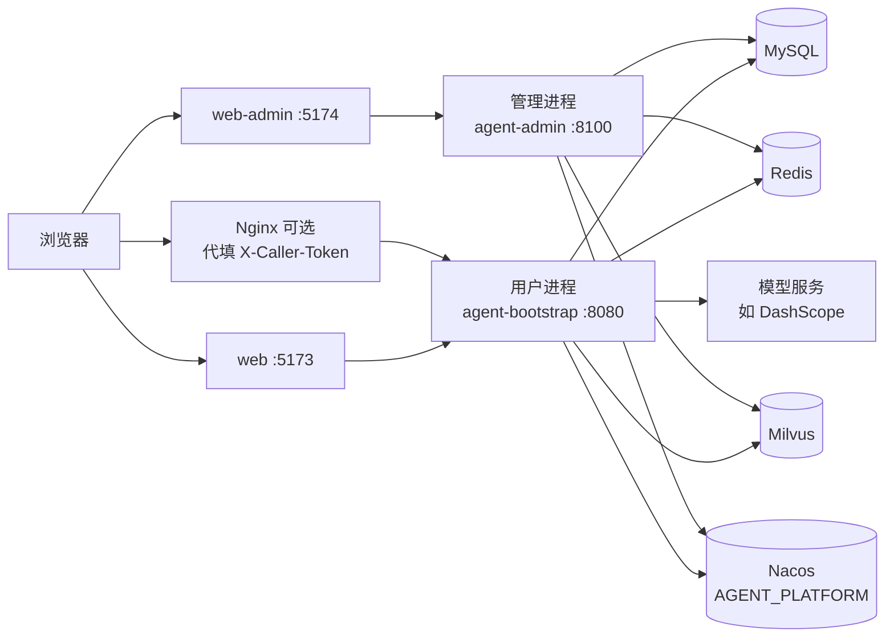
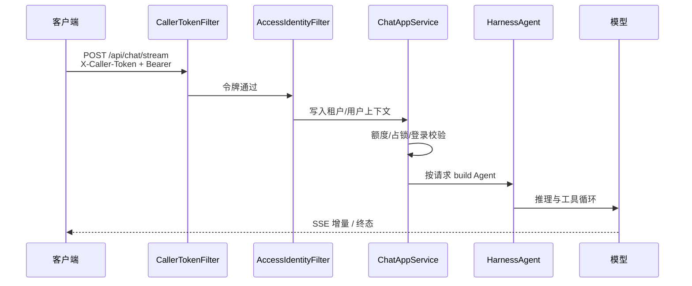

# dream-agentscope

Dream-SaaS 开源仓库：基于 [AgentScope Java](https://github.com/agentscope-ai/agentscope-java) 的多 Agent 平台底座。

同仓提供：

- **用户进程**（`agent-bootstrap`，默认 `8080`）：对话、登录、知识库、附件等业务 API
- **管理进程**（`agent-admin`，默认 `8100`）：租户、额度、工具权限、审批等运维 API（不跑对话）
- **用户端** `web`、**管理端** `web-admin`

仓库：<https://github.com/logosssss/dream-agentscope>  
在线站点：<https://www.dream-saas.com/>  
默认分支：`main`  
许可证：[Apache-2.0](./LICENSE)

> 根 README 负责「把项目跑起来 + 建立心智模型」。模块边界、接口清单与「还没有」见各子目录 `README.md`。

## 目录

- [项目是什么 / 不是什么](#项目是什么--不是什么)
- [架构鸟瞰](#架构鸟瞰)
- [环境与依赖](#环境与依赖)
- [本地启动（推荐：Nacos）](#本地启动推荐nacos)
- [配置优先级与令牌安全](#配置优先级与令牌安全)
- [前端联调（web / web-admin）](#前端联调web--web-admin)
- [演示种子、额度与公开演示](#演示种子额度与公开演示)
- [测试与门禁](#测试与门禁)
- [二次开发入口](#二次开发入口)
- [可选进阶](#可选进阶)
- [常见启动失败](#常见启动失败)
- [深入阅读](#深入阅读)
- [许可证与贡献](#许可证与贡献)

---

## 项目是什么 / 不是什么

### 已具备（产品能力）

| 能力 | 说明 |
|------|------|
| 密码注册 / 登录 / 退出 | 会话在 Redis；身份只认 `Authorization: Bearer`，不再信请求头里的租户/用户 |
| 智能搭子对话 | 同步 JSON + SSE 流式；HarnessAgent 按请求创建并关闭 |
| 待确认（审批） | 工具决策为 ASK 时出站内确认；用户可批准/拒绝；批准后需手动「重发上一条」 |
| 会话与运行查询 | 会话列表/消息、运行与任务只读查询（本人本租户） |
| 附件 | 上传、列表、下载、停用/恢复；对象可落 local / OSS / S3 / MinIO |
| 知识库 | 建库、纯文本/文件入库、索引状态、对话侧 `knowledge_search` |
| 额度与限流 | 日请求 / token / 费用等；分钟级限流；注册登录也走分钟限流 |
| 管理端运维面 | 租户与用户、各类额度、工具目录与权限、审批、模型配置与单价、审计只读、保留策略/调度登记、评测登记、账单状态机等（见 `web-admin`） |
| 微信扫码登录 | 密钥配齐后可用；小程序确认路径不校验 Caller Token（仍校验票与微信 code） |
| 配置中心 | Nacos 双份 yaml：infra 启动一次；业务可热更（白名单 + 非法拒收） |

### 明确不是什么 / 当前不做

- **RocketMQ / `agentscope.task.mode=mq`**：依赖未引入；切到 mq 会启动失败
- **Nacos 服务发现**；**MCP 服务发现**（清单可进用户进程业务配置，companion 已接线；不做把 MCP 当注册中心，见 `docs/mcp-落地.md`）
- **infra（连接/密钥）热更新**：改完需重启；只有业务 yaml 可热更
- **管理端账号登录页**：现阶段靠 Admin Token
- **保留策略真正清理、删除批准后真删、调度真正消费**：可登记/改状态，不执行落地清理
- **内置 Web 工具任意外连**：进程侧已 `disableWebTools` / `disableShellTool`；业务样例对 `web_fetch` / `web_search` DENY

---

## 架构鸟瞰

### 部署拓扑



要点：

- 用户进程执行 **Flyway**；管理进程**不**跑迁移、不依赖 runtime / access / Harness
- 两进程启动都必须能连上 **MySQL、Redis、Milvus**，否则退出（测试配置可关探测）
- 配了 `NACOS_ADDR` 时，启动必须拉到对应 **infra + 业务** 两份配置，缺一或正文空白则退出

### 一次对话请求（简化）



### 模块表

| 路径 | 说明 |
|------|------|
| [`agent-bootstrap`](./agent-bootstrap/README.md) | 用户进程入口，聚合扫描 `com.zhu` |
| [`agent-admin`](./agent-admin/README.md) | 管理进程入口 |
| [`agent-access`](./agent-access/README.md) | 用户侧 HTTP、身份、额度、聊天接入 |
| [`agent-runtime`](./agent-runtime/README.md) | 执行内核：HarnessAgent、中间件、工具挂载 |
| [`agent-semantic`](./agent-semantic/README.md) | 产品语义、提示词、工具目录与权限 |
| [`agent-audit`](./agent-audit/README.md) | 租户/审批/用量等审计与目录 |
| [`agent-state`](./agent-state/README.md) | DistributedStore / 远程工作区状态 |
| [`agent-vector`](./agent-vector/README.md) | Milvus 集合与检索相关 |
| [`agent-object-store`](./agent-object-store/README.md) | 对象存储抽象（local/OSS/S3/MinIO） |
| [`agent-common`](./agent-common/README.md) | 异常、DTO、上下文、令牌比较等 |
| [`web`](./web/README.md) | 用户端（介绍页、搭子、附件、知识库等） |
| [`web-admin`](./web-admin/README.md) | 管理端 |
| [`deploy/`](./deploy/) | Nacos / MySQL / Nginx / Milvus 示例 |
| [`docs/release-gate.md`](./docs/release-gate.md) | 开源前/上线前门禁清单 |

---

## 环境与依赖

| 类别 | 要求 |
|------|------|
| JDK | **21**（仓库根 `mvn`；勿用 JDK 8 的 `JAVA_HOME`） |
| 构建 | Maven 3.6+（与父 POM Spring Boot **3.5.5** 对齐） |
| AgentScope | `2.0.4`（父 POM `agentscope.version`） |
| Node | 建议 20+；前端包管理器统一 **pnpm**（勿与 npm 混用 lockfile） |
| MySQL | 用户与管理进程共用库；用户进程跑 Flyway |
| Redis | 会话、额度、占锁；Redis 失败返回 **503**，不回落内存/MySQL |
| Milvus | 用户进程连通后创建检索集合；管理进程只探测 |
| Nacos | **推荐**；group=`AGENT_PLATFORM` |
| 模型 | 默认坐标 `dashscope:qwen-plus`；密钥 `DASHSCOPE_API_KEY` 或写在 infra |

端口约定：用户进程 `8080`、管理进程 `8100`、用户前端 `5173`、管理前端 `5174`。

---

## 本地启动（推荐：Nacos）

### 1. 准备中间件

1. 创建库（可参考 [`deploy/mysql/create-database.sql`](./deploy/mysql/create-database.sql)）。
2. 确保本机可连 MySQL、Redis、Milvus；准备 Nacos（可本机或远程）。
3. 在 Nacos 控制台创建 group **`AGENT_PLATFORM`**，按模板粘贴四份配置（格式 YAML）：

| Data ID | 用途 | 模板 |
|---------|------|------|
| `agent-bootstrap-infra.yaml` | 用户进程连接/密钥（**不热更**） | [`deploy/nacos/agent-bootstrap-infra.yaml`](./deploy/nacos/agent-bootstrap-infra.yaml) |
| `agent-bootstrap.yaml` | 用户进程业务旋钮（**可热更**） | [`deploy/nacos/agent-bootstrap.yaml`](./deploy/nacos/agent-bootstrap.yaml) |
| `agent-admin-infra.yaml` | 管理进程连接/密钥（**不热更**） | [`deploy/nacos/agent-admin-infra.yaml`](./deploy/nacos/agent-admin-infra.yaml) |
| `agent-admin.yaml` | 管理进程业务（白名单可空，正文须非空） | [`deploy/nacos/agent-admin.yaml`](./deploy/nacos/agent-admin.yaml) |

infra 里 **Caller / Admin 令牌请留空**，用环境变量覆盖；**不要**使用 `change-me` / `change-me-caller` / `change-me-admin`（空白或占位串会导致进程拒绝启动，请求也会拒收）。

### 2. 环境变量

```bash
cp .env.example .env
```

至少填写：

| 变量 | 说明 |
|------|------|
| `NACOS_ADDR` | Nacos 地址；**为空则不连 Nacos** |
| `NACOS_NAMESPACE` | 命名空间（可空，视你的 Nacos 而定） |
| `NACOS_USERNAME` / `NACOS_PASSWORD` | Nacos 账号 |
| `AGENTSCOPE_CALLER_TOKEN` | 用户进程调用方令牌（强随机） |
| `AGENTSCOPE_ADMIN_TOKEN` | 管理进程令牌；**必须与 Caller 不同** |
| `DASHSCOPE_API_KEY` | 未写入 infra 时的模型密钥兜底 |

`NACOS_*` 四项必须留在环境变量，不要写进 Nacos 正文。

连接串也可只写在 infra；环境变量仍可覆盖同名项（优先级见下节）。

### 3. 演示租户种子

用户进程首次启动会跑 Flyway。表就绪后执行：

```bash
# 按你的客户端执行，例如：
mysql -u ... -p agentscope < deploy/mysql/seed-demo-tenant-user.sql
```

种子会登记 `demo` 租户与演示额度行；**不会**写入可登录密码，请走注册或微信扫码。

### 4. 启动后端

仓库根目录、JDK 21：

```bash
# 用户进程（Flyway + 业务 API）
mvn -pl agent-bootstrap -am spring-boot:run

# 另开终端：管理进程（可选，运维 UI 需要）
mvn -pl agent-admin -am spring-boot:run
```

探活：

```bash
curl -s http://127.0.0.1:8080/health/live
curl -s http://127.0.0.1:8080/health/ready
curl -s http://127.0.0.1:8100/health/live
curl -s http://127.0.0.1:8100/health/ready
```

`ready` 要求 MySQL / Redis / Milvus 可达。

### 5. 无 Nacos 时（短路径）

1. 保持 `NACOS_ADDR` 为空。
2. 打开 [`agent-bootstrap/src/main/resources/application.yml`](./agent-bootstrap/src/main/resources/application.yml) 文末「无 Nacos 本地兜底」注释块（管理进程对称处理）。
3. 用环境变量提供数据源、Redis、Milvus、Caller/Admin、模型密钥。
4. 仍须保证中间件连通，否则正式启动会退出。

无 Nacos 时没有业务热更；改旋钮需改本地配置并重启。

---

## 配置优先级与令牌安全

### 优先级

**环境变量 > Nacos > 本地 yml**

- **infra**：启动合并一次，**不热更**；改连接/密钥后重启进程
- **业务 yaml**：白名单内键可热更；非法推送拒收并保留上一份；只影响之后新请求
- 允许键见各进程 classpath：`nacos-allowlist.yml`（用户：[`agent-bootstrap/.../nacos-allowlist.yml`](./agent-bootstrap/src/main/resources/nacos-allowlist.yml)；管理：[`agent-admin/.../nacos-allowlist.yml`](./agent-admin/src/main/resources/nacos-allowlist.yml)）

### 令牌

| 项 | 规则 |
|----|------|
| 请求头 | `X-Caller-Token` |
| 用户进程期望值 | `agentscope.caller.token` / `AGENTSCOPE_CALLER_TOKEN` |
| 管理进程期望值 | `agentscope.admin.token` / `AGENTSCOPE_ADMIN_TOKEN` |
| 空白 | 除探活等例外路径外全部 401；正式启动（依赖探测开启时）直接失败 |
| 文档占位串 | `change-me*` 等视为不安全：启动失败 + 请求拒收 |
| 用户登录 | 另需 `Authorization: Bearer <session>`；与 Caller Token 不是一回事 |

存活 `/health/live`、就绪 `/health/ready` 不校验 Caller Token。小程序确认 `POST /api/public/auth/wx/confirm` 不带 Caller Token（仍校验票）。

### 常用业务旋钮（示例）

完整默认见 [`deploy/nacos/agent-bootstrap.yaml`](./deploy/nacos/agent-bootstrap.yaml)：

- `agentscope.access.daily-limit` / `per-minute`：日请求与分钟限流（`0` 表示该项不限制；公开演示勿随意放开）
- `agentscope.runtime.model` / `max-iters` / `timeout-seconds` / `max-user-chars` / `max-write-bytes`
- `agentscope.auth.tenant-id`：自助注册进入的租户（须已登记且 `ACTIVE`）
- `agentscope.permission.rules`：MySQL 关闭时的工具权限；打开 MySQL 后以 `tool_permission` 表为准

---

## 前端联调（web / web-admin）

统一使用 **pnpm**（目录内已有 `pnpm-lock.yaml`）。

### 用户端 `web`

```bash
cd web
cp .env.example .env.local   # VITE_CALLER_TOKEN = AGENTSCOPE_CALLER_TOKEN
pnpm install
pnpm dev
```

默认 <http://127.0.0.1:5173>：`/` 介绍页；「开始使用」进入搭子等（未登录会跳转登录/注册）。开发态 Vite 把 `/api`、`/health` 代理到 `8080`。

说明见 [`web/README.md`](./web/README.md)。

### 管理端 `web-admin`

```bash
cd web-admin
cp .env.example .env.local   # VITE_ADMIN_TOKEN = AGENTSCOPE_ADMIN_TOKEN（勿与 Caller 混用）
pnpm install
pnpm dev
```

默认 <http://127.0.0.1:5174>。缺 Token 时顶栏提示且业务操作禁用。说明见 [`web-admin/README.md`](./web-admin/README.md)。

### 线上与本地差异

- **线上用户站点**：构建时**不要**设置 `VITE_CALLER_TOKEN`；由 Nginx `proxy_set_header X-Caller-Token` 代填（示例：[`deploy/nginx/dream-saas.com.conf.example`](./deploy/nginx/dream-saas.com.conf.example)，说明见 [`deploy/nginx/README.md`](./deploy/nginx/README.md)）
- **本地**：可用 `.env.local` 或 Vite 代理；与线上注入方式分开验收

---

## 演示种子、额度与公开演示

1. 执行 [`deploy/mysql/seed-demo-tenant-user.sql`](./deploy/mysql/seed-demo-tenant-user.sql)（含可选 `tenant_quota`）。
2. 公开演示前收紧 Nacos 业务配置中的 `daily-limit` / `per-minute`（模板默认约 `30` / `6`）。
3. 自行轮换 Caller / Admin / 模型密钥；仓库与 Issue 中不要粘贴真实密钥。
4. 注册接口在网关代填 Caller 后对外可达：依赖分钟限流与日额度；生产请再加网关层防护。

---

## 测试与门禁

仓库根目录、JDK 21：

```bash
mvn test
```

测试**不**连接真实 Redis / MySQL / Milvus / Nacos。

上线 / 开源前人工门禁见 [`docs/release-gate.md`](./docs/release-gate.md)（自动化全绿 + 固定冒烟路径）。

---

## 二次开发入口

1. 先读目标模块 README 的包表与「还没有」，再改代码。
2. **加工具**：实现产品工具并挂到语义/运行侧目录；权限用 `tool_permission` 或 Nacos `permission.rules`（`ALLOW` / `ASK` / `DENY`）。
3. **改额度 / 限流 / 模型坐标等业务旋钮**：优先改 Nacos 业务 yaml（白名单内），避免把密钥写进可热更文件。
4. **模块边界**：ArchUnit 在 `agent-bootstrap` 测试中约束依赖方向；不要让 access 直接碰 harness，不要让 admin 依赖 runtime。
5. 新增或修改代码按仓库约定写**中文注释**（类/方法说明职责与约束）。

---

## 可选进阶

| 主题 | 入口 |
|------|------|
| 微信扫码 | infra 配 `agentscope.wx.mini.app-id` / `app-secret`；行为见 [`agent-access/README.md`](./agent-access/README.md) |
| 对象存储 OSS/S3/MinIO | `agentscope.object-store.*`，见 [`agent-object-store/README.md`](./agent-object-store/README.md) |
| OpenTelemetry | infra `agentscope.otel.endpoint`；未配导出地址时 span 丢弃 |
| Nginx 生产代填 Token | [`deploy/nginx/README.md`](./deploy/nginx/README.md) |
| Milvus 旧集合清理 | [`deploy/milvus/drop-legacy-collections.md`](./deploy/milvus/drop-legacy-collections.md) |

默认本地路径只需 **local 对象目录 + DashScope 密钥 + 演示租户**，不必先开微信或云存储。

---

## 常见启动失败

| 现象 | 常见原因 | 怎么处理 |
|------|----------|----------|
| 进程启动即退出，日志含 `agentscope.caller.token is required` / `placeholder` | 令牌空白或仍是 `change-me*` | 换成强随机值，用环境变量覆盖；infra 样例令牌保持空串 |
| 启动退出：`nacos` / 拉配置失败 | 配了 `NACOS_ADDR` 但缺 dataId、group 不对、正文空白 | 检查 `AGENT_PLATFORM` 下四份配置是否齐全且非空 |
| 启动退出：`mysql/redis/milvus is required` | 中间件未起或地址错 | 先保证 `ready` 三依赖；核对 infra / 环境变量 |
| HTTP 401 `caller token is invalid` | 头未带、值不一致、或用了占位串 | 对齐 `X-Caller-Token`；管理端勿误用 Caller |
| 管理端一直 401 / 提示 caller invalid | `AGENTSCOPE_ADMIN_TOKEN` 与用户 Caller 相同或前端填错 | 两者必须不同；`VITE_ADMIN_TOKEN` 只对管理进程 |
| 注册/登录 503「登录暂不可用」 | MySQL 未开或凭证表未迁移 | 确认用户进程 Flyway 成功、库可达 |
| 注册进错租户 / 503 | `agentscope.auth.tenant-id` 指向的租户不存在或非 ACTIVE | 先跑种子或管理端登记租户 |
| 对话额度/限流立刻失败 | `per-minute`/`daily-limit` 过小或 Redis 异常 | 查业务配置与 Redis；Redis 失败应为 503 而非静默放行 |
| 前端能开页但 API 全挂 | 未起后端、代理端口错、本地未配 `VITE_*_TOKEN` | 先 curl 进程 health；核对 Vite 代理与 `.env.local` |
| 线上构建后浏览器无 Caller | 构建时写进了 `VITE_CALLER_TOKEN` 或 Nginx 未代填 | 生产构建不要带该变量；按 nginx 示例代填 |

---

## 深入阅读

| 文档 | 说明 |
|------|------|
| [`doc/AgentScope Java 2.0.4 产品级架构与工程落地指南 (2).md`](./doc/AgentScope%20Java%202.0.4%20产品级架构与工程落地指南%20(2).md) | 架构与工程设计长文 |
| [`doc/企业级多 Agent 平台前端工程开发方案 (1).md`](./doc/企业级多%20Agent%20平台前端工程开发方案%20(1).md) | 前端方案 |
| [`docs/tutorial/series-plan.md`](./docs/tutorial/series-plan.md) | 系列教程《AgentScope 落地实战》：选题池、进度与双平台发布约定 |

以上偏设计与历史口径；**行为以当前代码与各模块 README 为准**。

---

## 许可证与贡献

- 许可证：[Apache License 2.0](./LICENSE)
- 问题与讨论：请到本仓库 **GitHub Issues** 提交（勿在 Issue 中粘贴密钥、Token、内网地址）
- 欢迎 PR。建议流程：Fork → 功能分支 → 改动 → 仓库根目录 `mvn test`（JDK 21）通过 → 发起 PR
- 代码约定：模块边界勿破坏；新增/修改代码写中文注释；不要提交 `.env`、`oss.env`、真实密钥

公开演示与自建部署时，请自行配置额度/限流并轮换密钥。
