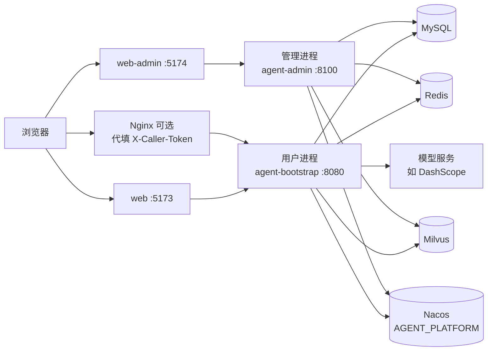
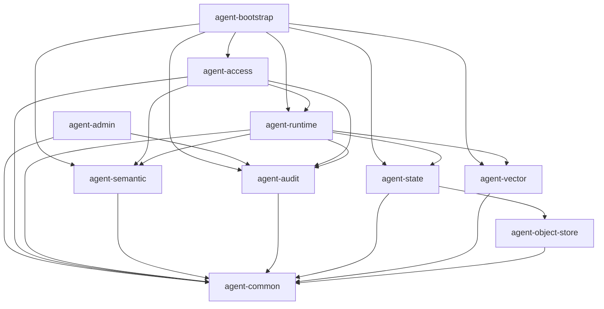
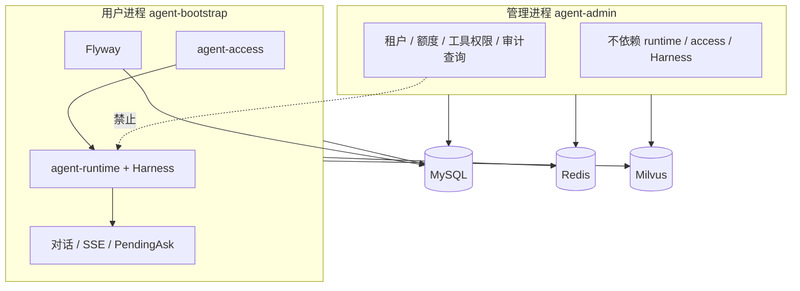

# 架构图（1～3）

结论权威：现码 / 根 [`README.md`](../../README.md) / 各落地文。索引见 [README.md](./README.md)。

## 1. 部署拓扑

双进程、双前端与中间件关系。用户进程执行 Flyway 与对话；管理进程不跑对话。

要点：两进程启动均须连上 MySQL / Redis / Milvus；配了 `NACOS_ADDR` 须拉到 infra + 业务两份配置。

## 2. 模块依赖方向

Maven 模块与 ArchUnit 禁向（可执行规则在 `ArchitectureTest`）。箭头表示「允许依赖」；红叉为禁止方向（示意）。

ArchUnit 要点（禁止）：

- `semantic` ↛ `runtime` / `access`
- `runtime` ↛ `semantic.application` / `semantic.infrastructure`（只碰 contract）
- `state` / `vector` / `objectstore` ↛ 业务包（语义/运行/接入等，细则见测试）
- `access` ↛ `io.agentscope..`；`access` ↛ `runtime.infrastructure`
- `access.api.controller` ↛ `infrastructure.persistence`

## 3. 管理进程边界

管理进程不依赖运行层、接入层、Harness；不执行 Flyway；不跑对话模型链路。

