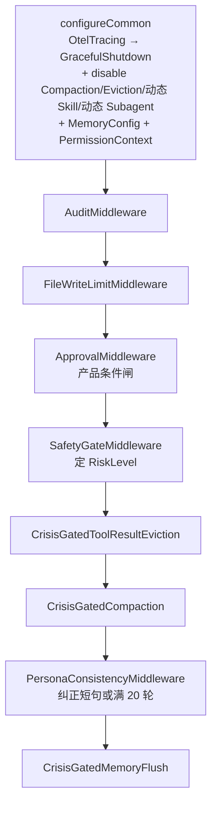
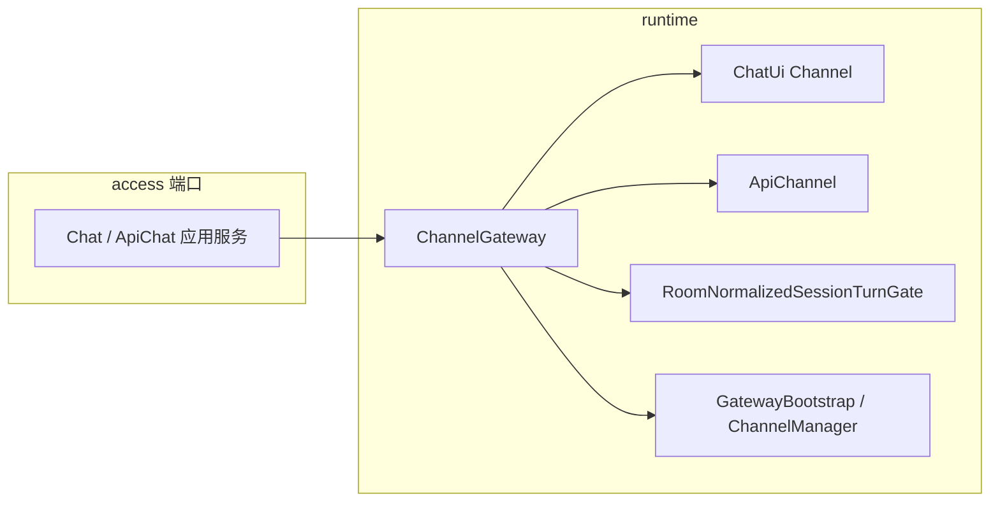
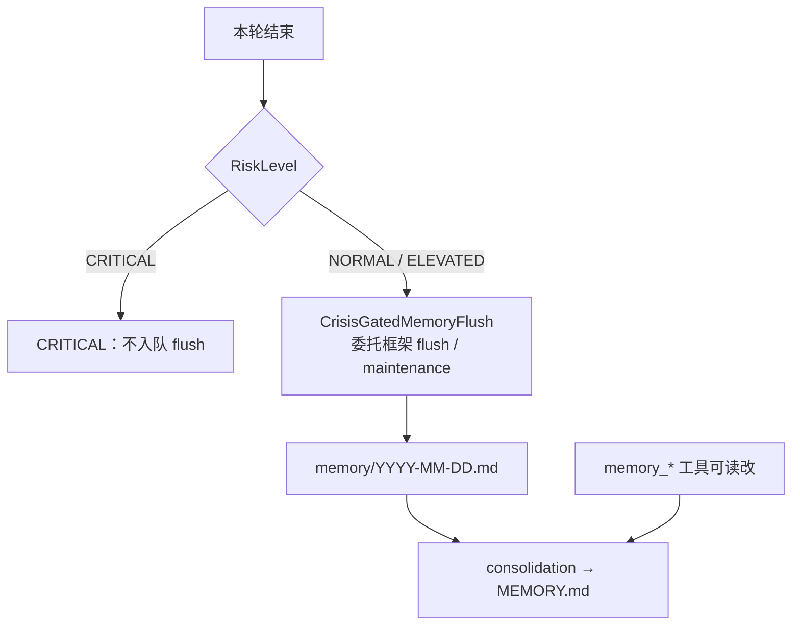
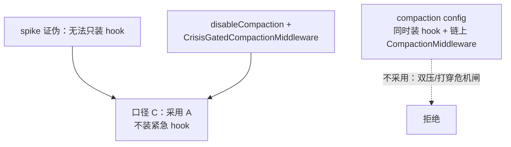
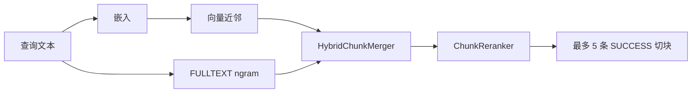

# 链路图（9～13）

结论权威：[`CompanionMiddlewareChain`](../../agent-runtime/src/main/java/com/zhu/runtime/infrastructure/agent/CompanionMiddlewareChain.java)（产品闸顺序）、[`HarnessAgentFactory`](../../agent-runtime/src/main/java/com/zhu/runtime/infrastructure/agent/HarnessAgentFactory.java)、各 `docs/*-落地.md`。索引见 [README.md](./README.md)。

## 9. companion 一轮 Middleware 顺序

`configureCommon` 先挂 tracing / shutdown；`customizeCompanion` 经 `CompanionMiddlewareChain.apply` 挂产品中间件。Eviction → Compaction 须在 SafetyGate 之后；CRITICAL 整段跳过 Eviction/Compaction；Memory flush 非 CRITICAL 才入队。

echo 不挂 c1～c8 产品闸；紧急 `compactionHook` **不装**（见 12）。

## 10. Channel Gateway + SessionTurnGate

白名单 `{chatui, api}`；同 room 跨 Channel 串行靠 room 归一化闸。

## 11. Memory：flush 与 CRITICAL

跨会话权威为用户工作区 `MEMORY.md`（Harness flush/consolidation，`memory_*` 已开）。情景/画像表已硬删。

## 12. CompactionHook 口径 C

公开 API 无法「只装 hook」：`compaction(config)` 会同时挂未闸 `CompactionMiddleware`。本仓 **不装**紧急 hook，保留 `disableCompaction` + 危机闸。

## 13. 知识检索链路

工具 `knowledge_search`：Hybrid 合并最多 20，再 Rerank 到 5；向量失败降级全文；Rerank 失败退回 Hybrid 原序。

