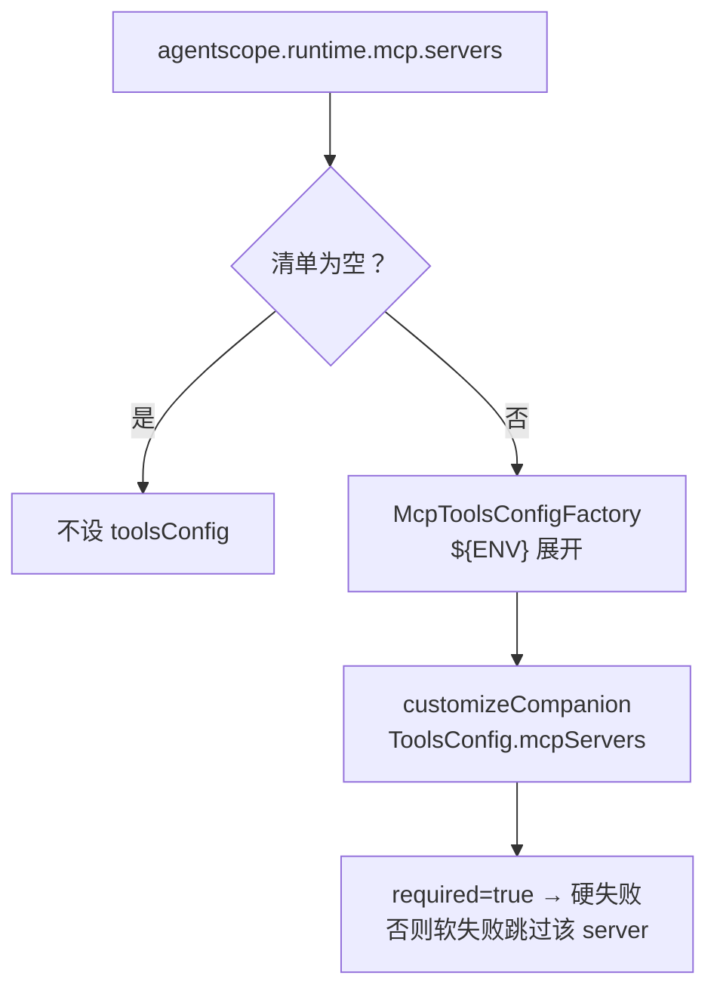
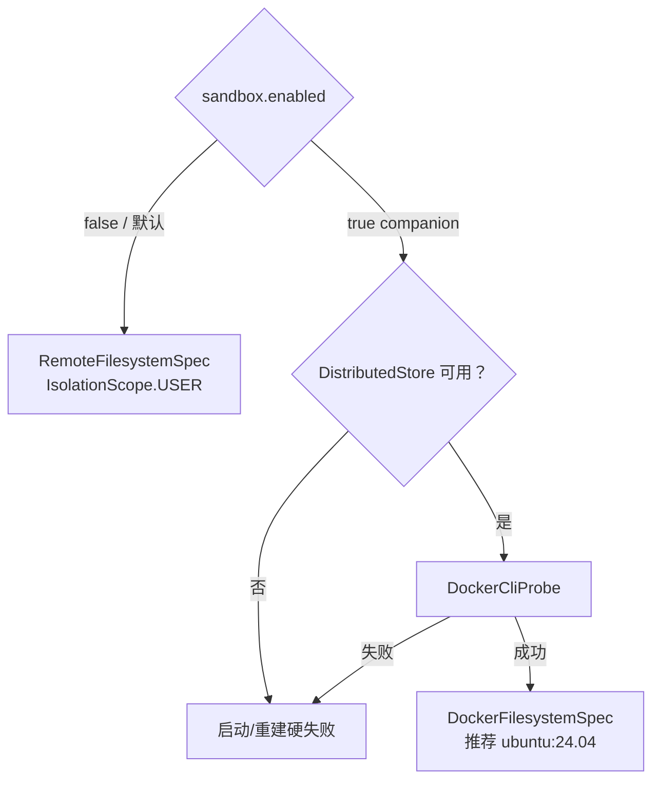
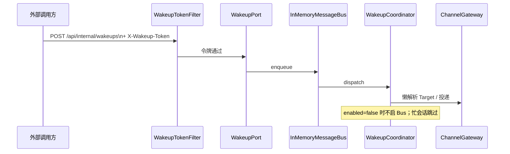
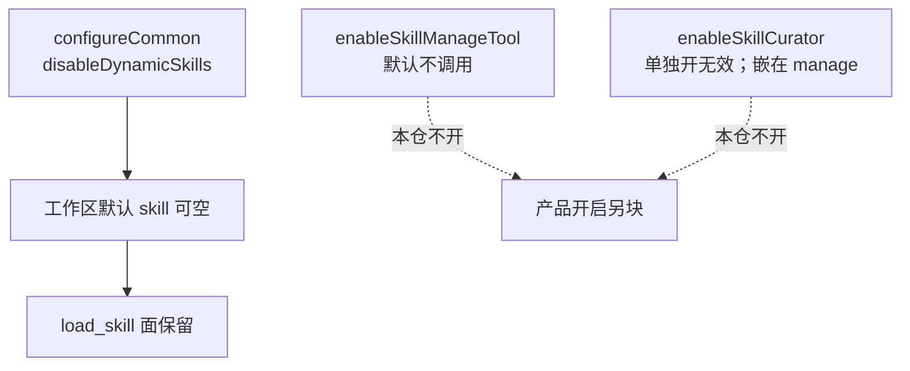
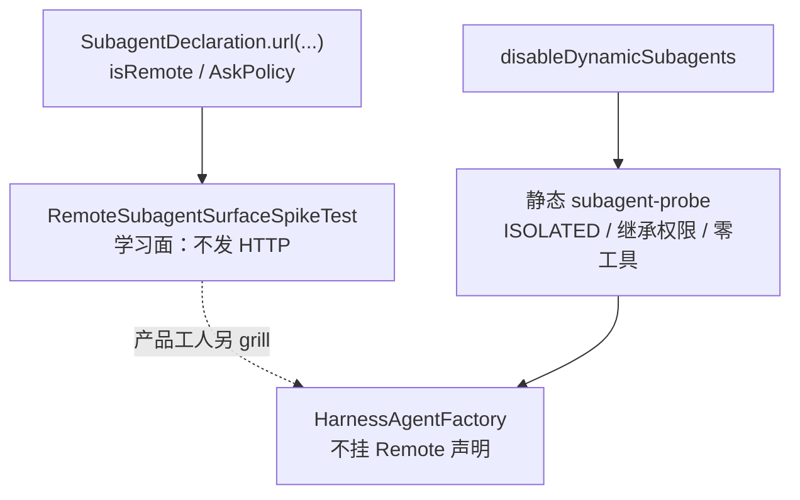

# 扩展面图（14～18）

须标「默认关」或「学习面」。结论权威：各 `docs/*-落地.md`。索引见 [README.md](./README.md)。  
不宣称产品 Remote 工人、`mode=mq`、MCP 服务发现已上线。

## 14. MCP 装配（空清单不连）

清单来自业务配置前缀 `agentscope.runtime.mcp.servers`；仅 companion；不做 MCP 服务发现；密钥不进 Nacos 明文。

## 15. Sandbox（默认关）

默认 Remote USER 工作区。`sandbox.enabled=true` 时仅 companion 换 Docker；缺 Store 或 `docker version` **硬失败**，不回退 Remote；echo 仍 Remote；shell 仍关。

## 16. Wakeup（默认关）

进程内 Bus；`POST /api/internal/wakeups` + `X-Wakeup-Token`（`AGENTSCOPE_WAKEUP_TOKEN` 仅环境变量）；仅 companion；忙会话跳过。不做调度表消费 / Inbox / TeamWakeups。

## 17. Skills / Curator（默认关 manage/Curator）

工厂 `disableDynamicSkills`；工作区默认 skill 仍开、目录可空、不写种子。不调 `enableSkillManageTool` / `enableSkillCurator`。Marketplace / Promotion / 产品开启另块。

## 18. Subagent（本地 probe；Remote 学习面）

companion 挂静态 `subagent-probe`（ISOLATED）；动态子代理关闭。Remote：声明面 spike 已钉，**工厂不挂**、非产品远程工人。

