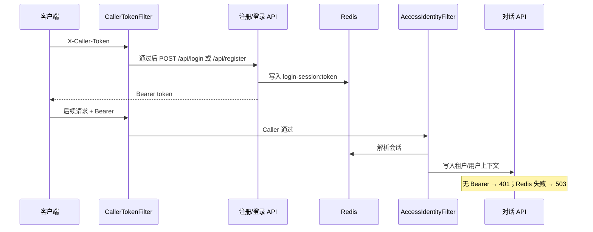
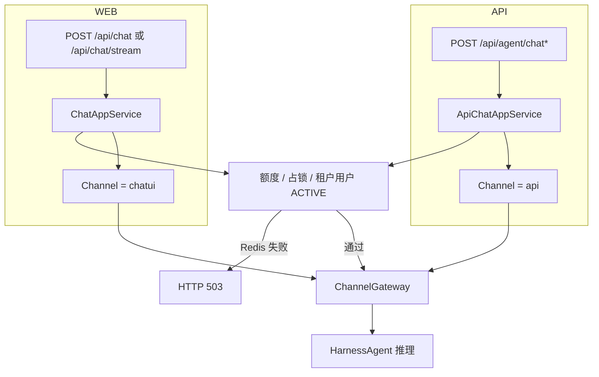
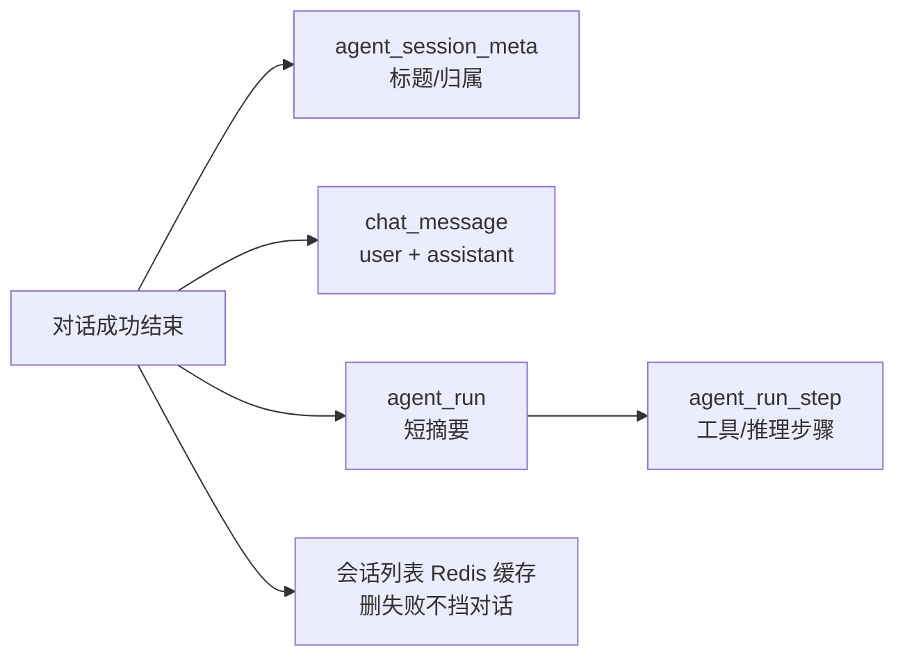
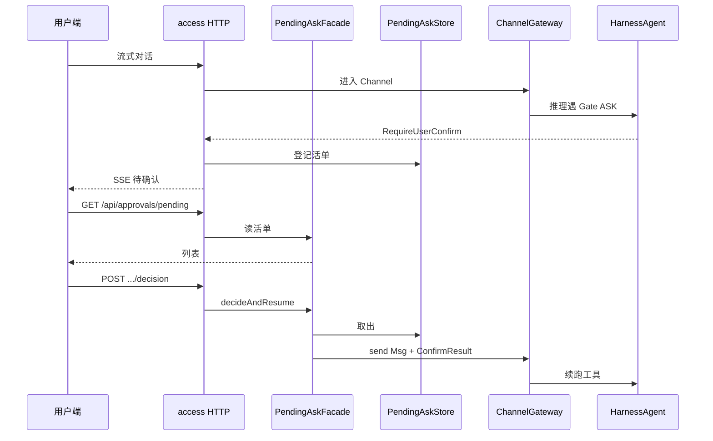
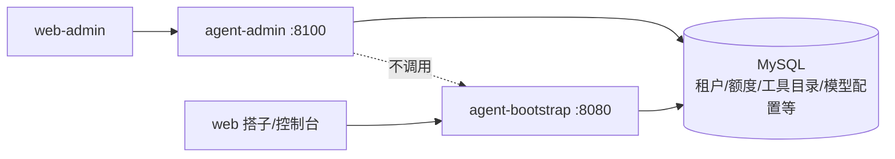

# 流程图（4～8）

结论权威：现码 / [`agent-access/README.md`](../../agent-access/README.md) / [`docs/permission-gate-落地.md`](../permission-gate-落地.md) 等。索引见 [README.md](./README.md)。

## 4. 登录 → Bearer → 对话准入

身份只来自登录会话；请求体/头不能指定用户。Caller 令牌与 Bearer 分工。

## 5. WEB vs API 对话主路径

`/api/chat*` → ChatUi（WEB）；`/api/agent/chat*` → API Channel。额度/占锁 Redis 失败返回 **503**，不回落内存/MySQL。

## 6. 成功轮次落库

写失败不改变已生成回复。MySQL 关闭仅测试场景。

## 7. ASK 续跑

权威在运行层 `PendingAsk*`；旧审批表已硬删。同步 chat 遇 ASK 不登记；流式登记后前端决策续跑。

## 8. 管理端相对用户进程

管理面改配置/查审计；不执行对话。用户进程读库内配置与目录。

