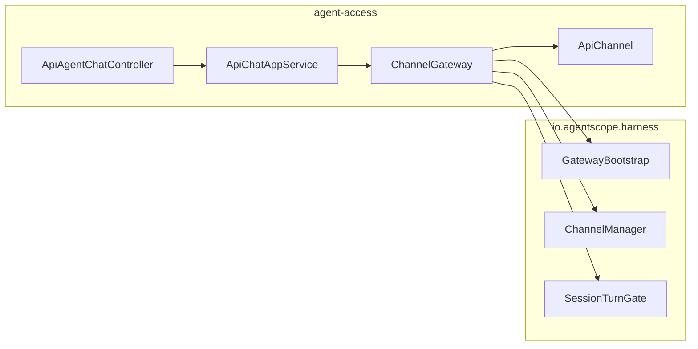

# 工程 / 模块评估（决策用）

日期：2026-11-16。  
用途：在**框架层已不必再调**的前提下，判断工程与模块侧要不要动、怎么动。非传播文。  
姊妹文档：[`docs/agentscope-landing-review.md`](./agentscope-landing-review.md)（框架用法 vs 工程契约）。  
本块**只交评估 + 文档对齐**；不改业务代码、不开防腐重构代码。

## 评估约定（grill 已锁）

| 项 | 约定 |
| --- | --- |
| 用途 | 决策清单；不立刻全量重构 |
| 覆盖 | 后端模块为主 + **文档/规则债**专节；前端 / deploy 点到为止 |
| 遗留清理 | 无运行依赖 → 可建议工程小改；有表 / 管理端只读依赖 → **须独立 grill** |
| 表轴 | 五轴总表 + 跨切故事 |
| access↔AgentScope | 终态 **C**：接入层尽量零 AgentScope 类型（含 PendingAsk / Wakeup） |
| 防腐推进 | **分阶段切片**；每片开工前再 grill |
| 测试 | 新测写到所属模块；旧测观察；防腐切片时可顺手提测 |
| 动作档 | 保持 / 观察暂不动 / 只改文档 / 工程小改 / **分阶段重构（须再按片 grill）** / 框架调整（本评估基本空） |

---

## 总判（先读这段）

1. **双进程 + 十模块切分应保持。** 管理进程不依赖 runtime / access / Harness；用户进程跑 Flyway——故障域清晰，ArchUnit 与 admin README 一致。  
2. **最大工程债不是「再拆 Maven 模块」，而是：**  
   - `agent-access` 的 gateway / approval / wakeup **集中引用** `io.agentscope.*`（产品形态正确，但与「接入层零框架类型」终态差距大）；  
   - 几乎全部单测堆在 `agent-bootstrap`（access / runtime 无独立 `src/test`）；  
   - Memory 等**软退役**表与类仍占认知与依赖面（审批软退役已硬删）。  
3. **框架升版与 Channel 产品路径已稳**（见 landing-review）；工程优化应走 **分阶段防腐史诗**，禁止一次「继续」打穿全 access。  
4. **防腐①已做**：ArchUnit「access 除 gateway 外禁 harness」+ README / 本表同步。防腐 ②～⑤ 与硬删表 **未开**。

---

## 一、五轴总表

| 轴 | 现状 | 债 / 优点 | 证据锚点 | 建议动作 |
| --- | --- | --- | --- | --- |
| 模块依赖与 ArchUnit | semantic↛runtime/access；runtime 不碰 semantic 实现；state/vector/object-store 不碰业务；access **除 gateway 外**禁 harness；controller 禁 persistence | **优点**：gateway 白名单已可执行；**债**：approval 仍可碰 core；终态零 AgentScope 在⑤ | [`ArchitectureTest.java`](../agent-bootstrap/src/test/java/com/zhu/bootstrap/ArchitectureTest.java)；[`agent-access/README.md`](../agent-access/README.md) | **①已完成**；全 access 禁 `io.agentscope` 放到防腐⑤ |
| 进程边界 | 用户 `8080` / 管理 `8100`；admin 不依赖 runtime、access、state、Harness | **优点**：管理面与对话面隔离 | [`agent-admin/README.md`](../agent-admin/README.md)；continue-landing 规则 | **保持** |
| access 内聚 | HTTP + 应用端口；AgentScope 类型已下沉 runtime | **已收口**（②+③+⑤） | ArchUnit `ACCESS_MUST_NOT_TOUCH_AGENTSCOPE` | **保持** |
| 遗留与软退役 | `approval_record` / 审批通知 **已硬删**；Memory 情景/画像 / `api.memory` / 旧 Middleware **已硬删** | **优点**：两处硬删已收口 | [`docs/approval-hard-delete-落地.md`](./approval-hard-delete-落地.md)；[`docs/memory-hard-delete-落地.md`](./memory-hard-delete-落地.md) | 审批与 Memory 硬删 **均已完成** |
| 测试与文档债 | 单测几乎全在 bootstrap；模块「还没有」段落极长；文档叠层（指南 / 落地 / handbook / 评估） | **债**：改一处行为要在巨型测试包里找；新人难定位 | `agent-bootstrap/src/test/...`；各模块 README「还没有」 | 新测 **工程小改**（下沉）；旧测 **观察**；文档 **只改文档** 渐进 |

---

## 二、跨切故事

### 故事 1：再改 / 加一条 Channel 要动哪里

- **必碰**：`ChannelGateway` 白名单与 Builder `.channel(...)`、新 Channel 实现、HTTP 应用服务、额度动作码约定、专题文档与 spike/接线测试。  
- **测试**：今天多半加在 `agent-bootstrap`（如 `ApiChannel*Test`）。  
- **含义**：Channel 扩展成本集中在 access↔harness 胶合层；防腐 ② 下沉适配器后，access 应只改「端口 + HTTP」，框架类型留在适配模块。

### 故事 2：硬删审批软退役链路要动哪里

- **已锁**：主路径 ASK 权威在框架 `pendingAsk` / 续跑；旧表硬删见 [`docs/approval-hard-delete-落地.md`](./approval-hard-delete-落地.md)（①～③ 已收口）。  
- **会碰到**（已落地）：Flyway `V40`、Recorder/管理端旧 API、通知表、`APPROVAL` 待办、牵连测与 `web-admin` 审批页。  
- **含义**：曾标独立 grill；现已完成，不并进防腐切片。

### 故事 3：把单测从 bootstrap 下沉的成本

- **现状**：`agent-runtime` 已有 `src/test`（T1 四测试点）；`agent-access` 等仍无；绝大多数用例仍在 bootstrap，便于一次 `mvn test` 与 ArchUnit 扫全 `com.zhu`。  
- **下沉收益**：模块责任清晰、改 access 不必心理负担「动了上帝包」。  
- **成本**：classpath / Spring 切片测试配置、重复测试工具类、CI 时间切分。  
- **建议**：不强制大搬家；**新测写到所属模块**；防腐某一片改动面大时再顺手提相关旧测。  
- **试点**：**已收口**（[`docs/bootstrap-test-sink-落地.md`](./bootstrap-test-sink-落地.md)）；旧测大搬家仍观察；不宣称测试债清完。

---

## 三、文档 / 规则债（专节）

| 项 | 问题 | 建议 |
| --- | --- | --- |
| access README / ArchUnit | 曾误写「整个 access 禁 harness」；后仅写 controller | **①已收口**：除 gateway 外禁 harness（可执行） |
| 模块「还没有」 | 单段过长，已交付与未做混排 | **D1 已收口**（runtime/access）；其余模块仍观察；见 [`docs/readme-debt-d1-落地.md`](./readme-debt-d1-落地.md) |
| 指南 vs 现码 | 长文含历史草案 | 已有 landing-review 漂移表 + handbook；**保持**「行为以现码为准」 |
| continue-landing 分支 | 已对齐 `feat/agentscope-channel-gateway` | **保持** |

前端 / deploy：点到为止——`web` 已有 api-console 与 chat-core 分流；deploy 脚本入口见技能与 `deploy/AGENT-DEPLOY*.md`。不在本评估开前端重构。

---

## 四、防腐史诗（终态 C · 分阶段）

### 终态

接入层（`com.zhu.access`）**尽量不再出现** `io.agentscope.*`（含 harness Channel/Gateway、core 的 `ConfirmResult` / `ToolUseBlock` 等）。对话编排仍可由 access 发起，但经**自有端口**；框架类型落在 runtime 或后续适配包。

### 默认切片顺序（每片开工前 `/grill-me` 可微调）

| 片 | 内容 | 预估动作档 |
| --- | --- | --- |
| ① | 文档对齐 + ArchUnit：access 除 `application.chat.gateway` 外禁 `..harness..` | **已完成** |
| ② | Channel/Gateway/SessionTurnGate/room 归一化下沉 runtime；`UserConfirmSink`；access 全禁 harness | **已完成**（WakeupCoordinator 一并迁入 runtime 以满足全禁 harness） |
| ③ | PendingAsk / 续跑相关 AgentScope 类型外迁；`PendingAskFacade`；删 `UserConfirmSink` | **已完成** |
| ④ | Wakeup 薄端口 `WakeupPort`；access 禁 `runtime.infrastructure` | **已完成** |
| ⑤ | ArchUnit：`com.zhu.access..` 禁止 `io.agentscope..` | **已完成**（并进③，规则名 `ACCESS_MUST_NOT_TOUCH_AGENTSCOPE`） |

### 明确不做（史诗内）

- 不借防腐之机硬删表（审批 / Memory 硬删已另专题收口）  
- 不改为对齐旧指南而放松 Redis 503  
- 不一次性新建巨型 `agent-gateway` 模块除非单片 grill 锁定  
- 不与 Remote Subagent / `mode=mq` 绑在同一片  

---

## 五、动作汇总

| 动作档 | 项 |
| --- | --- |
| **保持** | 双进程；admin 不依赖 Harness；Redis 503；API Channel 产品路径；防腐 ArchUnit access 禁 `io.agentscope` + `runtime.infrastructure` |
| **观察暂不动** | 旧测大搬家；其它模块「还没有」全文拆条；MCP/Sandbox 等产品开启 |
| **只改文档** | ~~D1 热点拆条~~ **完成**；其它模块「还没有」仍可选 |
| **工程小改** | **新**单测放到所属模块；bootstrap 测下沉试点见 [`docs/bootstrap-test-sink-落地.md`](./bootstrap-test-sink-落地.md)；局部注释 / 包说明 |
| **分阶段重构（须再按片 grill）** | 防腐史诗已收口（①～⑤）；新产品面另开 grill |
| **框架调整** | 本评估无新项（见 landing-review；2.0.5 已升） |

---

## 六、建议的下一步

1. ~~工程评估文 + 文档对齐~~ — **完成**  
2. ~~防腐史诗 ①～⑤~~ — **完成**  
3. ~~审批硬删 / Memory 硬删~~ — **完成**  
4. ~~bootstrap 测下沉试点~~ — **完成**（见 [`docs/bootstrap-test-sink-落地.md`](./bootstrap-test-sink-落地.md)）  
5. ~~对内图册~~ — **完成**（见 [`docs/diagrams/`](./diagrams/README.md)、[`docs/diagrams-落地.md`](./diagrams-落地.md)）  
6. ~~README 文档债 D1~~ — **完成**（见 [`docs/readme-debt-d1-落地.md`](./readme-debt-d1-落地.md)）  
7. **门禁复验 R1**：见 [`docs/release-gate-r1-落地.md`](./release-gate-r1-落地.md) — 按该文 ①→⑤「继续」  
8. 其后：R2 合并 `main`；或产品 Remote；或下一批测下沉 / 其它模块「还没有」  

## 状态

工程评估已交；防腐史诗 ①～⑤ **已收口**；审批硬删 **已收口**（见 `docs/approval-hard-delete-落地.md`）；Memory 情景/画像硬删 **已收口**（见 `docs/memory-hard-delete-落地.md`）；bootstrap 测下沉试点 **已收口**（见 `docs/bootstrap-test-sink-落地.md`）；对内图册 **已收口**（见 `docs/diagrams-落地.md`）；README 文档债 D1 **已收口**（见 `docs/readme-debt-d1-落地.md`）；门禁复验 R1 **已开锁文**（见 `docs/release-gate-r1-落地.md`）。
