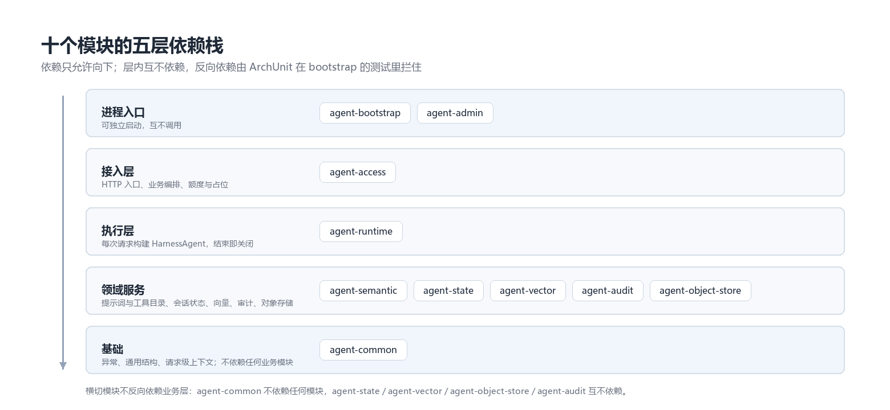
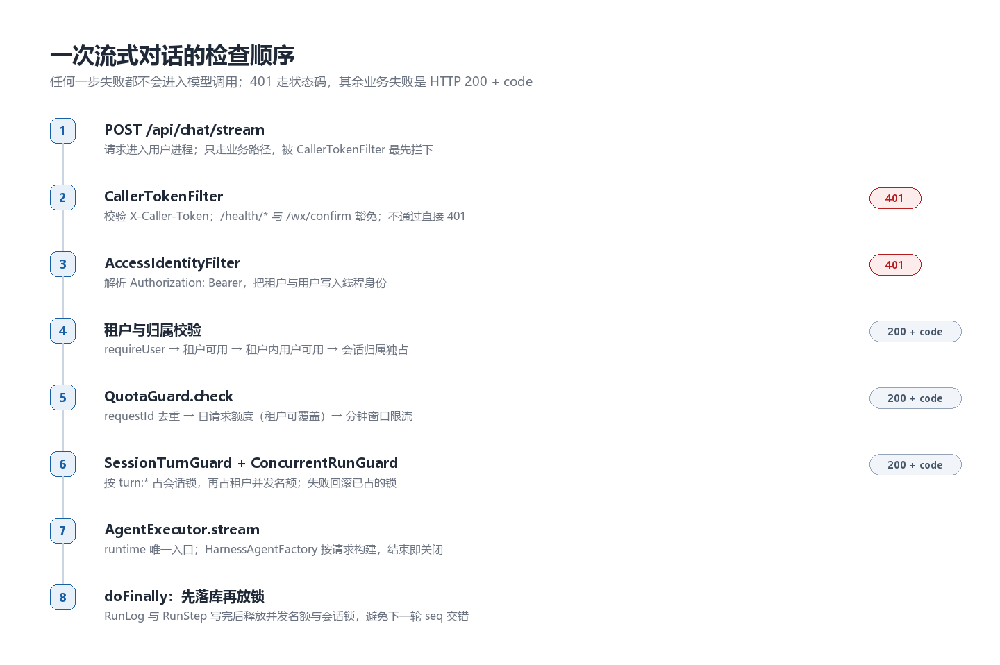
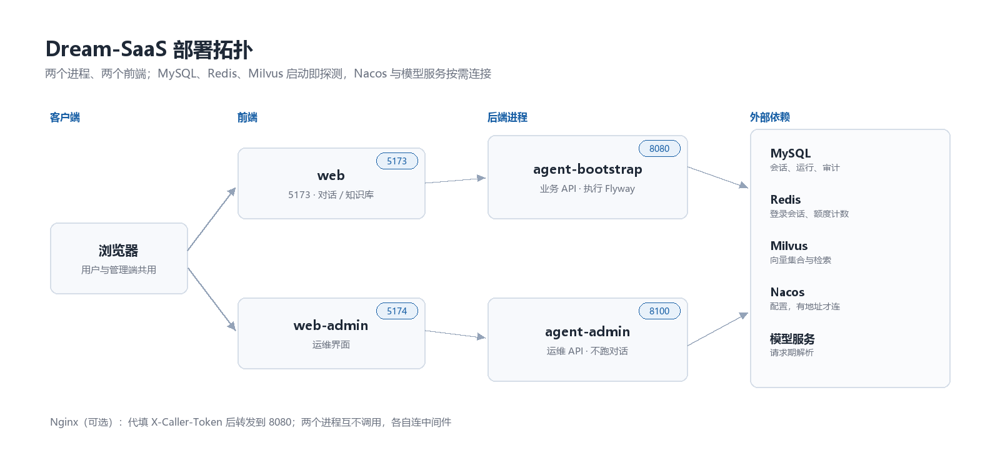

> **《AgentScope 落地实战》第 1 篇。** 代码基线 `lesson-01`，仓库：<https://github.com/logosssss/dream-agentscope>
>
> 这篇是系列总览，比公众号版本多五节：十个模块的分工、ArchUnit 边界测试、一次请求的七道检查、失败返回 200 的取舍、配置与迁移。

## 项目定位

dream-agentscope 是 Dream-SaaS 的开源仓库，基于 [AgentScope Java](https://github.com/agentscope-ai/agentscope-java) 2.0.4 构建的多 Agent 平台底座，采用 Apache-2.0 许可，在线站点为 <https://www.dream-saas.com/>。

它解决的不是"如何调用大模型"，而是"Agent 能力如何进入一个有租户、有计费、有审批、有审计的生产系统"。仓库在 AgentScope 之上补齐了六类产品化组件：

| 组件 | 作用 |
|---|---|
| 身份 | 密码注册登录、微信扫码登录、会话令牌 |
| 隔离 | 租户与用户维度贯穿对话、知识库、附件、配额 |
| 成本 | 日请求 / token / 费用 / 并发运行四类上限，分钟级限流 |
| 管控 | 工具权限三态（ALLOW / ASK / DENY）与审批流 |
| 留痕 | 运行、步骤、审计、用量四类记录 |
| 运维 | 配置中心热更、管理端、保留策略登记 |

以一次对话为例：请求进入用户进程后，先由 `CallerTokenFilter` 校验 `X-Caller-Token`，再由 `AccessIdentityFilter` 解析 `Authorization: Bearer` 并写入线程身份，接着在 `ChatAppService` 完成额度判断、运行占位与幂等检查，最后交给 runtime 构建 Agent 实例、把流式事件转成 SSE。多租户隔离与成本约束都压在这条链上，也是后续各篇逐段拆解的对象。

## 仓库结构

两个后端进程、两个前端工程、十个 Maven 模块。

| 组成 | 路径 | 端口 | 说明 |
|---|---|---|---|
| 用户进程 | `agent-bootstrap` | 8080 | 对话、登录、知识库、附件等业务 API；执行 Flyway |
| 管理进程 | `agent-admin` | 8100 | 租户、额度、工具权限、审批、审计等运维 API；不执行迁移、不跑对话 |
| 用户前端 | `web` | 5173 | 介绍页、对话、附件、知识库 |
| 管理前端 | `web-admin` | 5174 | 运维界面 |

十个模块中，`agent-bootstrap` 与 `agent-admin` 是两个可独立启动的进程入口，其余八个为库。依赖方向与边界约束见第 13 篇。

## 十个模块各自管什么

两个入口、一个接入层、一个执行内核、五个领域模块、一个基础模块。包名与 Maven 坐标一一对应，`com.zhu.<模块>` 就是模块边界。

| 模块 | 包名 | 职责 | 硬约束 |
|---|---|---|---|
| `agent-bootstrap` | `com.zhu.bootstrap` | 用户进程入口：对话、登录、知识库、附件、配置加载 | 唯一执行 Flyway 的进程 |
| `agent-admin` | `com.zhu.admin` | 管理进程入口：租户、额度、工具权限、审批、审计、账单 | pom 不含 `agent-runtime`，不加载对话链路 |
| `agent-access` | `com.zhu.access` | 过滤器、控制器、`ChatAppService`、额度、占位、幂等 | 不能引用 `harness` 类型；控制器不能碰持久化包 |
| `agent-runtime` | `com.zhu.runtime` | 执行内核：`AgentExecutor`、`HarnessAgentFactory`、流式事件 | 对 semantic 只能引用 `contract` 包 |
| `agent-semantic` | `com.zhu.semantic` | 提示词契约、工具目录、权限决定 | 不能依赖 runtime 与 access |
| `agent-state` | `com.zhu.state` | 会话状态、工作区文件、沙箱执行锁的持久化 | 不认识产品名，不调用模型 |
| `agent-vector` | `com.zhu.vector` | 集合确保与向量存取 | 只碰 Milvus SDK，不认识业务 |
| `agent-audit` | `com.zhu.audit` | 审计记录与审批落库的门面 | 不反向依赖被审计的模块 |
| `agent-object-store` | `com.zhu.objectstore` | 按相对键读写字节：local / OSS / S3 / MinIO | 不认识知识库、附件表与模型 |
| `agent-common` | `com.zhu.common` | 异常、通用数据结构、请求级上下文 | 不依赖任何业务模块，也不依赖 AgentScope |



*图 1：五层依赖栈。依赖只允许向下，层内模块互不依赖。*

这种切法带来两个直接后果。其一，`agent-admin` 不引入 `agent-runtime`，执行链路与模型密钥只存在于用户进程：管理端的 `model_config` 表只登记 `model`、`provider`、`version`，密钥来自用户进程的环境变量。其二，`agent-common` 没有任何 Spring Bean，也没有业务语义，因此可以被所有模块依赖而不产生环。

## 模块边界靠测试守住

模块边界写在 README 里等于没写。仓库用 ArchUnit 把七条禁止项做成可执行断言，跑在 `agent-bootstrap` 的测试阶段，违反即构建失败：

| 规则 | 禁止的依赖 |
|---|---|
| `SEMANTIC_MUST_NOT_DEPEND_ON_RUNTIME_OR_ACCESS` | semantic → runtime、access |
| `RUNTIME_ONLY_DEPENDS_ON_SEMANTIC_CONTRACT` | runtime → `semantic.application`、`semantic.infrastructure` |
| `STATE_MUST_NOT_DEPEND_ON_BUSINESS` | state → semantic、runtime、access |
| `VECTOR_MUST_NOT_DEPEND_ON_BUSINESS` | vector → state、semantic、runtime、access、admin |
| `OBJECT_STORE_MUST_NOT_DEPEND_ON_BUSINESS` | objectstore → state、semantic、runtime、access、admin、audit、vector |
| `ACCESS_MUST_NOT_TOUCH_HARNESS` | access → harness |
| `CONTROLLERS_MUST_NOT_ACCESS_REPOSITORIES` | 控制器 → `infrastructure.persistence` |

```java
JavaClasses classes = new ClassFileImporter().importPackages("com.zhu");
assertThat(classes.stream().map(JavaClass::getName))
        .contains("com.zhu.semantic.contract.ProductSemanticProvider",
                  "com.zhu.runtime.api.AgentExecutor",
                  "com.zhu.vector.api.VectorStore",
                  "com.zhu.access.api.controller.LivenessController");
SEMANTIC_MUST_NOT_DEPEND_ON_RUNTIME_OR_ACCESS.check(classes);
RUNTIME_ONLY_DEPENDS_ON_SEMANTIC_CONTRACT.check(classes);
```

中间四行是这些规则能否生效的关键。ArchUnit 扫不到类时，`noClasses()` 匹配空集合，规则会"通过"而不报错。先断言几个关键类确实被导入，才能保证后面的 `check` 真的在检查代码。

## 已具备的产品能力

| 能力 | 实现要点 |
|---|---|
| 注册 / 登录 / 退出 | 会话存于 Redis；身份只认 `Authorization: Bearer`，不采用请求头中的租户与用户 |
| 对话 | 同步 JSON 与 SSE 流式两条路径；`HarnessAgent` 按请求创建并在结束后关闭 |
| 待确认（审批） | 工具决策为 ASK 时产生站内确认；批准后需重新发送上一条消息，下一轮才执行工具 |
| 会话与运行查询 | 会话列表、消息、运行与步骤只读查询，范围限定本人本租户 |
| 附件 | 上传、列表、下载、停用与恢复；对象存储可落 local / OSS / S3 / MinIO |
| 知识库 | 建库、纯文本与文件入库、索引状态、对话侧 `knowledge_search` 工具 |
| 额度与限流 | 日请求、token、费用、并发运行四类上限；分钟级限流；注册登录同样受限 |
| 管理端 | 租户与用户、各类额度、工具目录与权限、审批、模型配置与单价、审计只读、账单状态机 |
| 微信扫码登录 | 密钥配齐后可用；小程序确认路径不校验 Caller Token，仍校验票据与微信 code |
| 配置中心 | Nacos 双份 yaml：infra 启动加载一次，业务配置可在白名单内热更 |

其中"审批"一项容易被理解错。用户点击确认只完成两件事：把审批记录置为通过、发出通知事件。工具不会因为"批准"这个动作被触发执行，原因是 Agent 的一轮是"模型决策 + 工具执行"的原子过程，在中间插入执行会产生半个轮次。正确做法是让用户重新发送上一条消息，下一轮模型看到批准结果后才真正调用工具。第 9 篇展开这条链路的实现。

## 技术栈与运行依赖

| 类别 | 版本 / 要求 |
|---|---|
| JDK | 21 |
| Spring Boot | 3.5.5 |
| AgentScope | 2.0.4 |
| 构建 | Maven 3.6+ |
| 持久层 | MyBatis-Plus 3.5.17 |
| 向量库 | Milvus 2.6.17（Java SDK） |
| 配置中心 | Nacos Client 3.2.1 |
| 可观测 | OpenTelemetry 1.61.0（可选） |
| 模块约束 | ArchUnit 1.4.1 |
| 前端 | Node 20+，包管理器统一 pnpm |
| 中间件 | MySQL、Redis、Milvus 三项必须可达 |
| 模型 | 默认坐标 `dashscope:qwen-plus`，密钥读取 `DASHSCOPE_API_KEY` |

三类外部依赖的启动行为不同：

| 依赖 | 启动期行为 |
|---|---|
| MySQL / Redis / Milvus | 两个进程启动即探测，任一项不可达则抛异常退出（`RequiredInfrastructureRunner`），避免"启动成功但对外随机 503" |
| Nacos | `NACOS_ADDR` 或 `agentscope.nacos.server-addr` 为空时跳过连接，回落到本地 `application.yml`；有值才连配置中心 |
| 模型服务 | 坐标与密钥在请求期解析，`DASHSCOPE_API_KEY` 缺失不阻断启动，首次对话或向量化时才失败 |

探测失败时抛出的原文可以直接用来定位：

```text
java.lang.IllegalStateException: mysql is required
java.lang.IllegalStateException: redis is required
java.lang.IllegalStateException: milvus is required
```

三句都由启动期 runner 抛出，进程随即退出，不会停在"端口已监听但请求全部失败"的状态。测试阶段把 `agentscope.startup.dependencies.enabled` 置为 `false`，该 runner 整体不装配，不连接真实中间件。

## 一次流式请求经过哪些检查

`POST /api/chat/stream` 是唯一会调用模型的入口。它在进入 runtime 之前要过七道检查，再占两个名额（会话锁、租户并发），任何一步失败都不会产生模型调用：



*图 2：顺序即语义。越靠前的失败越接近"无权访问"，越靠后越接近"暂时不能"。*

顺序写在 `ChatAppService.stream` 里：

```java
public Flux<AgentStreamEvent> stream(ChatRequest request) {
    AgentRequest agentRequest = toRequest(request);
    requireUser(agentRequest.userId());
    tenants.requireActive(agentRequest.tenantId());
    tenantUsers.requireActive(agentRequest.tenantId(),
                              agentRequest.userId());
    owners.requireExclusive(agentRequest.tenantId(),
                            agentRequest.userId(),
                            agentRequest.sessionId());
    quota.check(agentRequest.tenantId(), agentRequest.userId(),
                "chat-stream", RequestIdContext.get());
    SessionTurnGuard.Turn turn = turns.open(agentRequest.tenantId(),
                                            agentRequest.userId(),
                                            agentRequest.sessionId());
    ConcurrentRunGuard.Slot slot = concurrent.open(agentRequest.tenantId());
    // executor.stream(...)，doFinally 中先落库再释放 slot 与 turn
}
```

三个细节值得单独说。

**会话锁的键与 TTL。** 键是 `turn:{tenantId}:{userId}:{sessionId}`，值是随机 token，释放时校验 token 归属。TTL 取运行超时配置加 30 秒，留出的 30 秒覆盖"调用还没结束但锁已过期"的窗口。进程崩溃时锁不会永久占用，最迟在超时后自行放开。

**Redis 不可用时选择拒绝。** 占锁失败且原因是连接异常，抛 `UNAVAILABLE` 而不是放行。放行会让同一会话出现两轮并发写入，`seq` 交错后消息顺序无法修复；503 至少让调用方知道要重试。

**先落库再放锁。** `doFinally` 里的顺序是先写 `agent_run` 与 `agent_run_step`，再关并发名额，最后释放会话锁。反过来写会留一个窄窗口：锁已放开，下一轮抢到锁开始写 `seq`，而上一轮的记录还没落库，两条 run 的步骤会穿插在同一条会话里。

## 失败返回 200 还是 401

这一处与常见约定不同，值得单独说明。接入层的异常处理器只把两种错误码映射成 HTTP 状态：

| 错误码 | HTTP | 触发场景 |
|---|---|---|
| `UNAUTHORIZED` | 401 | 调用方令牌不对、登录会话失效 |
| `UNAVAILABLE` | 503 | Redis / MySQL / Milvus 不可用 |
| `BAD_REQUEST`、`NOT_FOUND`、`CONFLICT`、`QUOTA_EXCEEDED`、`INTERNAL` | 200 | 其余业务失败，看响应体里的 `code` |

```json
{"ok": false, "code": "QUOTA_EXCEEDED", "message": "daily quota exceeded", "data": null}
```

直接后果是：**调用方必须解析 `code`，只看 HTTP 状态码会把额度超限当成成功**。换来的是业务失败与传输失败在监控上可以分开统计——401 与 503 属于基础设施问题，`QUOTA_EXCEEDED` 属于业务量问题，两者的告警阈值不该共用一套。

## 部署拓扑

| 调用方 | 被调方 | 端口 | 说明 |
|---|---|---|---|
| 浏览器 | `web` | 5173 | 介绍页、对话、附件、知识库 |
| 浏览器 | `web-admin` | 5174 | 运维界面 |
| 浏览器 | Nginx（可选） | — | 代填 `X-Caller-Token` 后转发到 8080 |
| `web` | `agent-bootstrap` | 8080 | 业务 API |
| `web-admin` | `agent-admin` | 8100 | 运维 API |
| `agent-bootstrap` / `agent-admin` | MySQL、Redis、Milvus | — | 启动即探测，任一项不可达则退出 |
| `agent-bootstrap` / `agent-admin` | Nacos | — | 有地址才连，读取 infra 与业务两份 yaml |
| `agent-bootstrap` | 模型服务 | — | 坐标与密钥在请求期解析 |



*图 3：两个进程互不调用，各自连一套中间件；模型调用只发生在用户进程。*

只有 `agent-bootstrap` 会调用模型服务：`agent-admin` 的 pom 不依赖 `agent-runtime`，源码中也没有 `ChatModel` / `AgentExecutor` 引用。两个进程互不调用，管理端不可用时对话链路不受影响。

一次对话请求的路径：

```text
POST /api/chat/stream
  → CallerTokenFilter      校验 X-Caller-Token
  → AccessIdentityFilter   校验 Bearer，写入线程身份
  → ChatAppService         额度、占位、幂等
  → AgentExecutor.stream   runtime 唯一入口
  → HarnessAgentFactory    每次构建 Agent 实例
  → AgentStreamEvent       接入层转为 SSE
```

## 配置加载与数据库迁移

配置优先级为**环境变量 > Nacos > 本地 `application.yml`**，由启动期的 loader 合并成一份 `PropertySource` 后交给 Spring。四份 yaml 分成两组：`agent-bootstrap-infra.yaml` 与 `agent-admin-infra.yaml` 只在启动时读一次，改连接串、密钥、模型坐标必须重启；`agent-bootstrap.yaml` 与 `agent-admin.yaml` 里的业务配置可在白名单内热更。

数据库迁移只在一个地方执行：用户进程启动时的 Flyway。两个进程共用一套库，若都执行迁移，启动顺序会变成隐式依赖——先起来的那台负责改表，后起来的那台只能等它改完；把迁移收在用户进程，管理端可以在库就绪后随时重启，不影响表结构。当前共 39 个脚本，版本号最大为 `V39`，分散在各模块的 `src/main/resources/db/migration` 下，由 Flyway 按类路径汇总。

表结构不由 MyBatis-Plus 生成。这一点在部署时容易踩：手动建库后跳过 Flyway，第一次请求就会报表不存在。建库脚本与演示数据脚本都在 `deploy/mysql/`，演示数据需要手工导入：

```bash
mysql -u ... -p agentscope < deploy/mysql/create-database.sql
mysql -u ... -p agentscope < deploy/mysql/seed-demo-tenant-user.sql
```

种子脚本不参与 Flyway 版本管理，换环境重装时需要重新导入。

## 本地启动

前置条件：JDK 21、Maven、Node 20+、MySQL、Redis、Milvus，以及一个可用的 Nacos（推荐）。

```bash
# 1. 环境变量
cp .env.example .env

# 2. Nacos 控制台创建 group AGENT_PLATFORM，粘贴四份配置
#    agent-bootstrap-infra.yaml / agent-bootstrap.yaml
#    agent-admin-infra.yaml / agent-admin.yaml

# 3. 用户进程首次启动会执行 Flyway，随后导入演示租户
mysql -u ... -p agentscope < deploy/mysql/seed-demo-tenant-user.sql

# 4. 启动
mvn -pl agent-bootstrap -am spring-boot:run
mvn -pl agent-admin -am spring-boot:run

# 5. 探活
curl -s http://127.0.0.1:8080/health/live
curl -s http://127.0.0.1:8080/health/ready
```

`/health/ready` 要求三项中间件可达，`/health/live` 只表示进程在运行。两个端点都不需要 `X-Caller-Token`，这是 `CallerTokenFilter` 里显式放行的路径，否则容器探活会被 401 拦掉。

前端分别执行 `pnpm install && pnpm dev`。生产构建时不设置 `VITE_CALLER_TOKEN`，由 Nginx 通过 `X-Caller-Token` 代填——令牌不进前端产物，也不出现在浏览器请求头里。

## 当前未实现的部分

- **RocketMQ**：`agentscope.task.mode=mq` 为占位实现，切换后进程无法启动；任务当前走 `sync`。
- **服务发现与 MCP**：Nacos 仅作为配置中心。
- **infra 热更新**：仅业务 yaml 在白名单内可热更。
- **保留策略、删除审批、调度消费**：支持登记与状态变更，不执行实际清理。
- **管理端账号登录页**：当前依赖 Admin Token。
- **内置 Web 工具**：进程侧已关闭 `web_fetch` / `web_search` / shell 工具，业务样例对前两者配置为 DENY。

## 适用与不适用

**适用**：需要把 Agent 接入多租户系统、要求额度与审批可控、希望保留完整运行记录的后端团队；作为 AgentScope Java 的工程化参考实现。

**不适用**：只需要单机对话 Demo 的场景；需要开箱即用的低代码 Agent 编排平台；需要 MCP 工具生态的场景（当前未接入）。

## 系列说明

《AgentScope 落地实战》共四个部分：项目与框架入门、RAG 落地、多 Agent 编排、上线与运维。全部内容对应仓库中已存在的实现，配置值与默认值直接取自代码与 `deploy/` 模板。这一篇是总览，后续每篇只展开一个环节，并给出可 `git checkout` 的 tag。

---

**下一篇**：AgentScope 2.0.4 概念地图——Agent、Toolkit、Memory、Middleware 的职责边界，以及一个 200 行以内的最小闭环。

**有问题评论区见，欢迎交流~**

项目：https://www.dream-saas.com/ ｜ 仓库：https://github.com/logosssss/dream-agentscope ｜ 系列目录：https://github.com/logosssss/dream-agentscope/blob/main/docs/tutorial/series-plan.md
