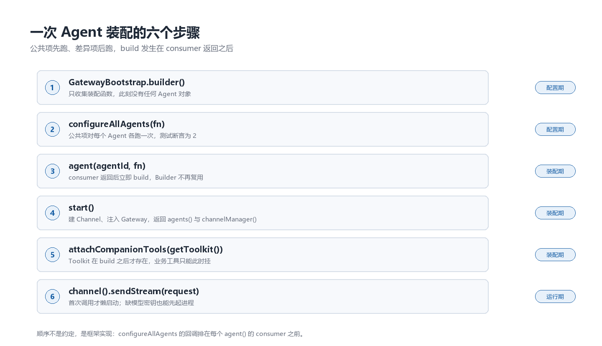
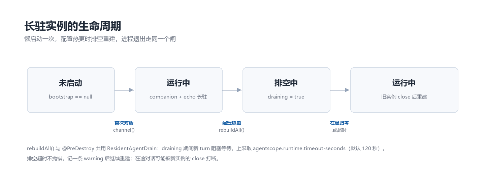
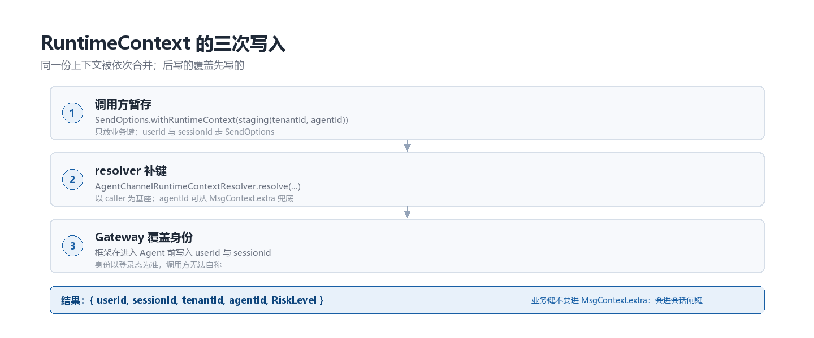

> **《AgentScope 落地实战》第 2 篇。** 代码基线 `lesson-02`，仓库：<https://github.com/logosssss/dream-agentscope>
>
> 这篇比公众号版多三节：97 行测试的结构、排空与停机的走读、运行配置默认值；另展开几处代码细节——接入层六道门的调用顺序、`doFinally` 的收尾顺序、`Model` 桩的契约。

## 最小闭环是仓库里的一个测试，不是文档里的示例

仓库没有 demo 模块。能独立跑通的最小闭环在 `agent-bootstrap` 的测试目录：`AccessChannelBootstrapAgentTest`，97 行，其中不到 20 行是一个返回固定文本的 `Model` 桩。没有 Spring 容器，没有数据库，从装配走到回复。

```java
GatewayBootstrap bootstrap = GatewayBootstrap.builder()
        .configureAllAgents(builder -> {
            builder.model(model);
            builder.disableWebTools();
            builder.disableShellTool();
            builder.maxIters(1);
        })
        .agent("companion-v1", builder -> builder.name("companion")
                .agentId("companion-v1").sysPrompt("companion"))
        .mainAgent("companion-v1")
        .channel(ChatUiChannel.create())
        .build()
        .start();

Msg reply = ChannelGateway.requireChatUi(bootstrap.channelManager())
        .send(SendOptions.of("u1", "s1"), "hi")
        .block(Duration.ofSeconds(5));
```

这段代码里的每个类型，在正式链路里都对应一个位置。把它们的边界记住，比记 API 名字有用：正式链路出错时，先判断问题落在哪个对象上，再去看那一层的代码。

这篇要回答三个问题：五个对象的边界在哪里、一条消息在它们之间怎么走；装配期、启动期、请求期各发生什么；哪些约束违反之后不报错，只在并发或热更时表现成别的问题。

## 一、五个对象

| 对象 | 职责 | 正式链路里的位置 |
|---|---|---|
| `GatewayBootstrap` | 装配入口，一次性建好所有 Agent 与 Channel | `ChannelGateway.startGatewayLocked` |
| `HarnessAgent.Builder` | 可变的装配器，每个 Agent 一个 | `HarnessAgentFactory.configureCommon` / `customizeCompanion` |
| `Channel` | 收发消息的通道，不是 HTTP 控制器 | `ChatUiChannel`（WEB）、`ApiChannel`（程序调用） |
| `Msg` | 一轮消息；回复、审批确认都靠它 | `ChannelGateway.execute` / `resumeConfirm` |
| `RuntimeContext` | 一次调用的上下文，跨中间件传递 | `AgentTurnSupport.context` |

`Channel` 容易被当成 Controller 用。它不处理 HTTP，也不做鉴权，只负责把一条用户消息交给 Gateway 并把事件流吐回来；鉴权与额度在 `agent-access` 里已经做完，进到 Channel 的只有 `userId`、`sessionId` 和文本。

`Msg` 的另一个用途是审批续跑。用户在页面上点"允许"之后，回到 Gateway 的不是一段新对话，而是一个带 `METADATA_CONFIRM_RESULTS` 元数据的 `Msg`，`resumeConfirm` 把它交给同一个 Agent 续跑。所以"点确认"和"发消息"在框架层是同一件事。

## 二、一条消息的走读：六道门与四件事

把五个对象连起来看，一次对话分三段：接入层、Gateway、Channel。接入层在 `ChatAppService`，同步与流式用的是同一串门禁，顺序固定：

1. 拒绝显式 `channel=API`：WEB 入口只接默认通道，程序调用走 `ApiAgentChatController`。
2. 请求体转 `AgentRequest`，身份只取登录会话写进线程的值，请求体里的 `userId` 丢掉。
3. `requireUser` → `tenants.requireActive` → `tenantUsers.requireActive` → `owners.requireExclusive`。
4. `quota.check` 记额度。
5. `concurrent.open` 占租户并发名额。
6. `remember` 落会话，之后才 `executor.execute`。

同步与流式的差别只在这串门禁的最后两行：

```java
// 同步：execute 返回后 finally 放名额
quota.check(agentRequest.tenantId(), agentRequest.userId(), "chat", RequestIdContext.get());
ConcurrentRunGuard.Slot slot = concurrent.open(agentRequest.tenantId());

// 流式：流结束时才在 doFinally 里收尾
quota.check(agentRequest.tenantId(), agentRequest.userId(), "chat-stream", RequestIdContext.get());
ConcurrentRunGuard.Slot slot = concurrent.open(agentRequest.tenantId());
```

`quota.check` 的 `scene` 参数在这里分成 `chat` 与 `chat-stream`，便于按入口统计。`QuotaGuard` 的类注释写清了记账方向：请求次数在入口累加，token 与费用在出口记账后累加，入口只读已用量；同一份提交在 10 分钟幂等窗口内只扣一次。并发名额不在这里，是下一步 `ConcurrentRunGuard.open` 单独占的。

顺序不是随手排的：租户与归属校验在额度之前，无效请求不会消耗额度计数；额度在并发占位之前，被额度拒绝的请求不占名额；会话落库在占位之后，记失败就释放名额并让这一轮失败，不会留下"有名额没记录"的状态。

流式那条路的收尾还有一处顺序：`doFinally` 里先 `finish(...)` 落运行记录，再 `concurrent.close(held)` 放名额，注释写的是"避免同租户下一轮抢名额"。反过来写，下一个请求可能在记录落库前就拿到名额，运行记录里出现时间上的倒挂。

进到 `ChannelGateway` 之后只剩四件事：`turns.require` 校验请求、`drain.beginTurn` 记一次在途、`turns.context` 建本地上下文、`options()` 拼好 `SendOptions` 交给 `channel().send`。同步、流式、API 通道三条路是同构的，差别只在最后调 `send` 还是 `sendStream`。

```java
private SendOptions options(AgentRequest request) {
    String agentId = turns.agentId(request);
    SendOptions options = SendOptions.of(request.userId(), request.sessionId())
            .withRuntimeContext(AgentChannelRuntimeContextResolver.staging(request.tenantId(), agentId));
    if (agentId != null && !agentId.isBlank() && !agentId.equals(mainAgentId)) {
        options = options.withAgentId(agentId);
    }
    return options;
}
```

这段里有一处容易看漏：会话用请求里的 `sessionId`，调用方只暂存 `tenantId` 与 `agentId`；`agentId` 为空或等于 `mainAgentId` 时不改路由，仍走 Bootstrap 的 main Agent。

通道名不进 `AgentRequest`。`channel` 只在接入层用于会话列表展示与入口选择，运行层拿不到它，也不需要知道这条消息是从网页还是从程序调用进来的。

回程同理：Channel 吐 `AgentEvent`，经 `turns.mapStreamEvent` 变成 `AgentStreamEvent`，最后由 Controller 包成 `ServerSentEvent`。HTTP、SSE、鉴权都在最外两层，五个对象里没有一个知道它们存在。

## 三、公共项对每个 Agent 各跑一次

`configureAllAgents` 看起来像"全局配置，执行一次"，实际不是。测试里有三个计数器，断言是：

```java
assertThat(commonHits.get()).isEqualTo(2);
assertThat(companionHits.get()).isEqualTo(1);
assertThat(echoHits.get()).isEqualTo(1);
```

两个 Agent，公共回调跑了两次。框架的顺序是：对每个 `agent(id, consumer)`，先跑 `configureAllAgents` 的回调，再跑该 Agent 自己的 consumer，consumer 返回后立即 `build()`。



*图 1：装配顺序。三个期间里，只有最后一步在请求路径上；前五步都发生在首次调用或热更时。*

整段装配分三个期间、六步：

- 装配期，每个 Agent 三步：公共回调 → 该 Agent 的 consumer → `build()`。
- 启动期，两步：`start()` 建 Channel；从 `agents()` 取实例挂工具。
- 请求期，一步：`channel().send(...)`。

这带来三个约束：

- 公共回调里不能放"只执行一次"的动作——累加计数、注册全局监听、开连接池，都会按 Agent 数量重复。
- 差异项拿到的 Builder 已经带着公共项，只能覆盖，不能撤销。公共项里调用的 `disableWebTools`、`disableShellTool`、`disableDynamicSkills`、`disableDynamicSubagents`，在 `customizeCompanion` 与 `customizeEcho` 里都没有对应的开启调用；要给某个 Agent 单独放开，得另写一段装配。
- build 在 consumer 返回后立即发生，consumer 里不能把 Builder 存起来异步使用。

`HarnessAgentFactory` 的类注释把这条写成了一句硬约束：**不要在线程之间共享同一个 Builder 再改提示词。**

两组装配合起来是 30 处 Builder 调用：公共项 12 处，搭子差异 18 处。公共项决定这个进程不允许做什么，差异项决定这个 Agent 是谁。

## 四、工厂只持有"消费者"

`HarnessAgentFactory` 是单例 `@Component`，字段里没有任何 Builder：只有配置、模型解析器、中间件、工具列表。这些部件本身要么无状态，要么由 Spring 保证单例安全，所以工厂可以单例。

单例能成立的前提是"每轮状态都不在 Bean 里"。中间件是 Spring 单例，但 `tracing`、`shutdown`、`audit` 这些中间件不持有会话状态，判定结果写进 `RuntimeContext`，随调用走。工厂负责的是"怎么装"，不是"装完放在哪"。

反例是把 Builder 放进字段：

```java
// 错误示范，不是仓库代码
private final HarnessAgent.Builder builder; // 单例字段

public void build(String prompt) {
    builder.sysPrompt(prompt); // 两个并发请求互相覆盖
    builder.build();
}
```

这个错误难查的原因不是编译期能发现，而是 setter 不报错、覆盖发生在并发窗口内，表现为"回复里出现另一个用户的设定"。正式链路里每个 Agent 只有一个 consumer，Builder 由框架在 build 前创建，用完即弃。

同一种错误模式也出现在懒启动入口：`channel()` 用双检锁，两个并发首请求只有一个会走 `startGatewayLocked()`。去掉双检锁不会立刻报错，但冷启动时并发的两个请求会各自建一套 Agent，后写入的那套覆盖前一套，前一套没人 `close()`，模型连接与工具资源留在进程里。

## 五、长驻实例，懒启动

一个常见误解是"每次对话 new 一个 Agent"。当前实现不是：`ChannelGateway.channel()` 用双检锁拿 `ChatUiChannel`，`bootstrap == null` 时才 `startGatewayLocked()` 建 Agent。构造器注释写得明确：**只接线，不立刻建模型；缺 DASHSCOPE_API_KEY 时仍允许进程起来。**



*图 2：四个状态的唯一入口是 `channel()` 与 `rebuildAll()`；两条路都经过同一把排水闸。*

| 时点 | 发生什么 | 代价 |
|---|---|---|
| 进程启动 | 只装配 Spring Bean，不建 Agent | 缺模型密钥也能启动，故障推迟到首次对话 |
| 首次对话 | 建 companion 与 echo，挂中间件与工具 | 首个请求需先完成装配再出字 |
| 配置热更 | `rebuildAll()`：排空在途 → 停旧 → 建新 | 期间新请求阻塞等待 |
| 进程退出 | `@PreDestroy` 走同一把排水闸 | 最长等待 `timeout-seconds`，默认 120 秒 |

排水闸是 `ResidentAgentDrain`：`draining = true` 后，新 `beginTurn()` 在锁上循环等待；在途归零或超时后执行动作。超时不抛错，只记一条 warning 后继续重建，所以在途对话可能被新实例的 `close()` 打断——这是"热更优先于长尾请求"的取舍。

重建还有一处连带影响：`stopLocked()` 会清空 `PendingAskStore`，热更窗口内没处理的审批不会跨实例保留，需要客户端重新发起。停机走的是同一把闸，但多一层框架侧配置——`AgentShutdown` 注册 `GracefulShutdownConfig(timeout, PartialReasoningPolicy.SAVE)`，不再接新调用，已生成的推理内容保留；注册动作放在 `ApplicationRunner` 里，避免停机顺序抢在 Web 容器前面。

## 六、Toolkit 在 build 之后才存在

`customizeCompanion` 里挂不了业务工具，因为那时 Toolkit 还没创建。工具只能在 `start()` 之后、从 `agents()` 里取到实例再挂：

```java
HarnessAgent companion = started.agents().get(mainAgentId);
// Toolkit 要等 build 之后才有
agents.attachCompanionTools(companion);
```

`CatalogToolRegistrar` 做的是白名单过滤：目录里的 `toolId` 集合决定哪些实现会被注册，同一标识只注册第一次，目录为空时直接返回、不改 Toolkit。所以"加一个工具"不是改代码就行，还要在工具目录里登记，否则实现类存在也不会出现在模型的工具列表里。

```java
if (!allowed.contains(tool.toolId()) || !seen.add(tool.toolId())) {
    continue; // 不在目录里，或重复标识，静默跳过
}
```

"只注册第一次"这条也和装配顺序绑在一起：同一 `toolId` 出现两个实现时，谁先注册谁生效，后一个被 `continue` 跳过，既不报错也不打日志。注册器的注释还留了一句：传入的 Toolkit 应是这次 Agent 自己的，不要改共享实例。

工具集合的变更同样要靠重建生效，不能在运行中往 Toolkit 里加。

## 七、RuntimeContext 写三次

上下文不是构造一次传到底，而是三层依次合并：

```java
SendOptions.of(userId, sessionId)
        .withRuntimeContext(AgentChannelRuntimeContextResolver.staging(tenantId, agentId));
```



*图 3：调用方只能写业务键；身份字段由 Gateway 在进入 Agent 前覆盖。*

1. 调用方暂存：只放 `tenantId` 与 `agentId`，身份字段走 `SendOptions`。
2. resolver 补键：以 caller 为基座补 `tenantId`，`agentId` 还能从 `MsgContext.extra` 兜底。
3. Gateway 覆盖：进入 Agent 前写入 `userId` 与 `sessionId`，以登录态为准。

第三层的方向是单向的：调用方写不进去，只能被覆盖。所以"前端传一个 userId 冒充别人"在上下文这一层不成立，能改身份的只有登录态。

有一条约束写在 resolver 的注释里：**业务键不要塞进 `MsgContext.extra()`，那会进会话闸键。** 会话闸按 key 做同会话串行，把租户之类的字段塞进去，会让同一会话的两个请求落进不同键。

读取侧有两种写法：`context.get("tenantId")` 取字符串，`context.get(RiskLevel.class)` 取类型化对象。后者是中间件之间传递判定结果的通道：`SafetyGateMiddleware` 写入 `context.put(RiskLevel.class, assessment.level)`，`CrisisGatedMemoryFlushMiddleware`、`CrisisGatedCompactionMiddleware`、`AgentTurnSupport.critical` 都读它来决定是否跳过。

用类型当键的好处是不会和字符串键撞名，代价是同一类型只能承载一个值：两处中间件都写 `RiskLevel` 时，留下的是后写的那个，顺序变成了语义的一部分。

## 八、30 个装配点

`HarnessAgentFactory` 里共有 30 处 Builder 调用，分两组。

**公共项（12 处）**

| 分组 | 调用 | 作用 |
|---|---|---|
| 能力开关 | `disableWebTools` / `disableShellTool` | 未做出口白名单前关闭内置 web 与 shell |
| 记忆 | `memory(MemoryConfig)` / `disableMemoryHooks` | 开跨会话记忆，关框架自带 flush hook |
| 上下文治理 | `disableCompaction` / `disableToolResultEviction` / `disableDynamicSkills` / `disableDynamicSubagents` | 四个动态能力显式关闭，改由产品中间件接管 |
| 权限与追踪 | `permissionContext` / `middleware(tracing)` | 无条件规则 + `OtelTracingMiddleware` |
| 停机与状态 | `middleware(shutdown)` / `distributedStore` | 优雅停机闸；有 Store 才挂 |

**搭子差异（18 处）**

| 分组 | 调用 |
|---|---|
| 身份 | `name` / `agentId` / `model` / `sysPrompt` / `maxIters` / `workspace` |
| 子代理与 MCP | `subagent` / `toolsConfig` / `mcpServerRegistrationListener` |
| 文件系统 | `filesystem`（Sandbox 开则 Docker，否则 Remote） |
| 中间件 | `audit` / `fileWriteLimit` / `approval` / `safetyGate` / `crisisGatedToolResultEviction` / `crisisGatedCompaction` / `personaConsistency` / `crisisGatedMemoryFlush` |

中间件的实际顺序由装配顺序决定，没有显式排序：公共项先跑，所以 `tracing`、`shutdown` 在链首；搭子再按调用顺序追加 `audit → fileWriteLimit → approval → safetyGate → eviction → compaction → persona → memoryFlush`。

这个顺序是有语义的：`safetyGate` 之前不能截断内容，否则危机判定拿不到原文；`eviction` 必须在 `compaction` 之前，先截大工具结果再压历史；`memoryFlush` 放最后，靠本轮已确定的 `RiskLevel` 决定是否入队。

`maxIters` 也不是取单一来源：先读运行配置，配成小于 1 时退回产品域的 `completion.maxIterations()`，仍无效时按 20。测试里显式设成 1，是为了让桩模型一轮就结束。

## 九、事件出口不暴露框架类型

`chat.sendStream(...)` 吐的是框架的 `AgentEvent`，接入层拿到的是 `AgentStreamEvent(type, text)`：

```java
public static AgentStreamEvent from(AgentEvent event) {
    String type = event.getType().name().toLowerCase();
    return new AgentStreamEvent(type, textOf(event));
}
```

`text` 按事件种类取短文本，四类分支：

- 增量事件：取 `getDelta()`。
- 工具开始：取工具名。
- 审批事件：取逗号拼接的工具名。
- 结束事件：取全文，并过一遍 `ModelTextGuard.outbound`。

工具参数与完整提示词不放进 `text`。理由是这一层同时给前端和日志用，参数里可能带用户原文，一旦进 SSE 就等于把出站检查绕过去了。

这层的价值在于隔离：框架升级换事件类，改的是 `textOf`，SSE 输出格式不动。

## 十、五条约束汇总

| 约束 | 违反后的现象 |
|---|---|
| 公共项会按 Agent 数量重复执行 | 计数翻倍、监听重复注册 |
| Builder 不可跨线程共享 | 提示词互相覆盖，回复串人设 |
| Agent 是长驻的，热更靠重建 | 改配置不生效，或运行中改工具丢失 |
| Toolkit 只能在 build 之后挂 | 工具注册为空，模型看不到工具 |
| 业务键不进 `MsgContext.extra` | 同会话串行失效 |

五条里有四条不会在启动时报错，只会在并发、热更、或者某次审批续跑时表现成"看起来像模型的问题"。判断顺序建议按对象来：先看请求进没进 Gateway（`drain` 与 `runId`），再看 Channel 有没有被懒启动起来，最后看 Agent 里挂的工具与中间件是不是这一版。

## 十一、97 行测试的结构

测试只有五个部分。全文 97 行，去掉空行与注释后 87 行，其中近 20 行是 `Model` 桩：

| 部分 | 作用 |
|---|---|
| 计数器 | 三个 `AtomicInteger`，用来验证公共项与差异项的执行次数 |
| `Model` 桩 | 实现 `stream` 与 `getModelName`，固定返回 `ok` |
| 装配 | `GatewayBootstrap.builder()` 链，两个 Agent，一个 Channel |
| 断言 | 执行次数、`agents()` 的键集合、`mainAgentId()` |
| 收尾 | `bootstrap.stop()` 加逐个 `agent.close()` |

`Model` 桩是理解模型接入面的最短路径：

```java
private static Model replyModel(String name) {
    return new Model() {
        @Override
        public Flux<ChatResponse> stream(List<Msg> messages, List<ToolSchema> tools,
                                         GenerateOptions options) {
            return Flux.just(ChatResponse.builder()
                    .id("r1")
                    .content(List.of(TextBlock.builder().text("ok").build()))
                    .finishReason("stop")
                    .build());
        }

        @Override
        public String getModelName() {
            return name;
        }
    };
}
```

两个方法就是全部契约：`stream` 按 Reactor 流返回 `ChatResponse`，`getModelName` 供记账与日志使用。 `tools` 参数是按本轮 Toolkit 生成的 `ToolSchema` 列表，模型桩忽略它不影响链路跑通——这也是用桩做测试的前提。

正式链路里的模型名不是硬编码：`ResolvedChatModel.resolve(tenantId)` 先查启用中的模型配置，没有行才回落到 `agentscope.runtime.model`。装配时调用的是 `resolve(null)`，记账时再按 `tenantId` 取一次。

## 十二、排空与停机的走读

`rebuildAll()` 的全部逻辑在一个 `drainAndRun` 里：

```java
public void rebuildAll() {
    Duration timeout = Duration.ofSeconds(Math.max(1, turns.timeoutSeconds()));
    drain.drainAndRun(timeout, () -> {
        synchronized (lock) {
            if (bootstrap == null) {
                return; // 还没懒启动过
            }
            stopLocked();
            startGatewayLocked();
        }
    });
}
```

`stopLocked()` 做四件事：`bootstrap.stop()`、注销 `HarnessAgentRegistry`、逐个 `close()`、清空待确认记录。最后一件容易被忽略：**重建会清空 `PendingAskStore`**，热更窗口内未处理的审批需要在客户端重新发起，不能指望旧实例的待确认在重启后还在。

`@PreDestroy` 的 `shutdown()` 用同一把闸，等待上限同样是 `timeoutSeconds`。另有 `AgentShutdown` 在启动完成后向框架注册 JVM 停机钩子，配置为 `GracefulShutdownConfig(timeout, PartialReasoningPolicy.SAVE)`：停机时不再接新调用，已生成的推理内容保留。注释说明了注册时机——放在 `ApplicationRunner` 里拿管理器，避免停机顺序抢在 Web 容器前面。

## 十三、运行配置默认值

`@ConfigurationProperties(prefix = "agentscope.runtime")`，代码里的默认值：

| 配置项 | 默认值 | 说明 |
|---|---|---|
| `model` | `dashscope:qwen-plus` | 模型坐标；可被模型配置覆盖 |
| `agent-id` | `companion-v1` | 状态命名空间，也是默认路由键 |
| `name` | `companion` | Agent 名称 |
| `max-iters` | `20` | 单轮最多迭代次数，小于 1 时走产品域配置 |
| `timeout-seconds` | `120` | 单次调用超时，也是排水与停机的等待上限 |
| `max-user-chars` | `32768` | 用户输入上限，超出在 `ModelTextGuard.beforeCall` 拦截 |
| `max-write-bytes` | `5242880` | 单次写文件上限，由 `FileWriteLimitMiddleware` 执行 |

这七项里，`timeout-seconds` 影响面最大：它同时是 `Flux.timeout`、排空等待、停机等待三处的上限。调大它会让热变更慢，调小它会打断长回答。

下一篇进入流式本身：`streamEvents` 的取消、超时与末帧语义，以及为什么流式下不能边推边审核。

**下一篇**：流式不是加个 SSE 就完了。

仓库：<https://github.com/logosssss/dream-agentscope> ｜ 系列目录：<https://github.com/logosssss/dream-agentscope/blob/main/docs/tutorial/series-plan.md>
