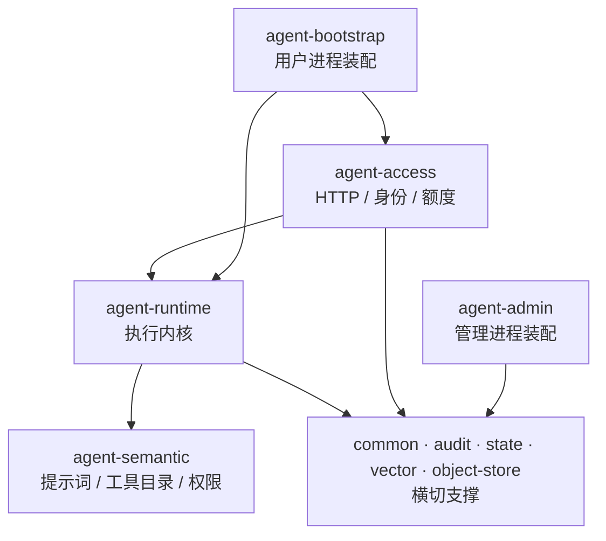

> **《AgentScope 落地实战》第 13 篇。** 代码基线 `lesson-13`，仓库：<https://github.com/logosssss/dream-agentscope>
>
> 上一篇：额度、限流、幂等 ｜ 下一篇：观测与成本。

## 单进程结构的三处失效

Agent 能力可以全部实现在一个 Spring Boot 应用里，管理接口以 `/admin/**` 前缀区分。该结构在演示阶段无问题，进入生产后会在三处失效。

**权限面无法收敛。** 管理接口校验 Admin Token，业务接口校验 Caller Token 加登录会话。两者在同一进程内，任一处过滤器配置遗漏、任一条路径匹配写错，业务侧请求即可到达管理接口。

**故障域相互传染。** 审计查询、账单状态机、保留策略均消耗数据库连接。与对话共用同一连接池时，一次慢查询会阻塞正在流式输出的对话。

**发布节奏不一致。** 对话内核要求稳定，运维面改动频繁。合并部署时，修改一个审计字段需要重启对话服务。

代价是双进程部署、双份配置，且数据库迁移只能由其中一个进程执行。

## 进程切分

| 项 | 用户进程 `agent-bootstrap` | 管理进程 `agent-admin` |
|---|---|---|
| 端口 | 8080 | 8100 |
| 职责 | 对话、登录、知识库、附件 | 租户、额度、工具权限、审批、审计 |
| 数据库迁移 | 执行 Flyway | 不执行，只读表结构 |
| 模块依赖 | access / runtime / harness | 不含 runtime、不含 access |
| 令牌 | `AGENTSCOPE_CALLER_TOKEN` | `AGENTSCOPE_ADMIN_TOKEN`，必须不同 |

两个进程启动时均要求 MySQL、Redis、Milvus 可达，任一项不可达则退出。该策略的取舍是明确的：**启动失败优于带残缺依赖提供服务**。依赖不可达时启动成功，对外表现为随机 503，排查成本高于直接退出。

令牌相同会导致管理端持续返回 401。这是设计约束，用于禁止一套凭证同时具备两类权限。

## 模块切分



| 模块 | 职责 | 拆分依据 |
|---|---|---|
| `agent-bootstrap` | 用户进程入口，聚合扫描 `com.zhu` | 仅装配，不含业务 |
| `agent-admin` | 管理进程入口 | 与对话内核零依赖 |
| `agent-access` | 认证后的 HTTP 入口、线程身份、额度 | 协议扩展只改此模块 |
| `agent-runtime` | Agent 生命周期、中间件、工具挂载 | 不含 HTTP，可独立复用 |
| `agent-semantic` | 产品语义、提示词、工具目录与权限 | 文案变更不影响执行逻辑 |
| `agent-audit` | 租户、审批、用量审计与目录 | 事件总线，解耦上下游 |
| `agent-state` | 分布式存储、远程工作区 | 会话状态与产品无关 |
| `agent-vector` | Milvus 集合与检索 | 向量库替换只改此模块 |
| `agent-object-store` | local / OSS / S3 / MinIO 统一接口 | 存储选型不进入业务层 |
| `agent-common` | 异常、DTO、上下文、令牌比较 | 无业务归属的基础类型 |

依赖关系构成有向无环图，而非分层结构。`agent-common` 可被任意模块依赖，自身不依赖其他模块；`agent-runtime` 依赖 `agent-semantic` 的契约包，反向依赖禁止。

## 三条被强制的边界

架构约束以 ArchUnit 测试实现，`mvn test` 阶段校验。

**一、接入层禁止引用 Harness。** `com.zhu.access` 不得 import `..harness..`。接入层只依赖 `AgentExecutor` 接口，与具体 Agent 框架解耦；框架替换的影响范围限定在 runtime。

**二、runtime 禁止依赖 access。** 反向依赖会形成循环，且执行内核感知 HTTP 层后，控制器逻辑会逐步内移。工具需要 ASK 审批时的通知路径是：runtime 发布 `agent-audit` 事件，接入层订阅。

**三、管理端禁止依赖 runtime。** 管理端需要的是数据访问，不是执行能力。依赖 runtime 会将模型调用与向量检索引入运维进程。

三项约束的效果是：不阅读业务代码，仅依据各模块 pom 即可判断改动的影响范围。

## 一次对话请求的模块路径

```text
POST /api/chat/stream
  → CallerTokenFilter      校验 X-Caller-Token
  → AccessIdentityFilter   校验 Bearer，写入线程身份
  → ChatAppService         额度、占位、幂等
  → AgentExecutor.stream   runtime 唯一入口
  → HarnessAgentFactory    每次 new Builder 后 build
  → agent.streamEvents     推理与工具循环
  → AgentStreamEvent       接入层转为 SSE
```

容器中不存在 `HarnessAgent` 类型的 Bean。原因是 Builder 为可变对象，注册为单例后并发请求会互相覆盖提示词。构建逻辑位于工厂内部，每次请求新建，`finally` 中关闭。

该结构的直接约束是 Agent 不持有跨请求状态，会话、轮次、记忆必须显式持久化。这也是水平扩容的前提条件。

## 当前未实现的部分

- **RocketMQ**：`agentscope.task.mode=mq` 为占位实现，切换后进程无法启动；任务当前走 `sync`。
- **服务发现与 MCP**：Nacos 仅作为配置中心使用。
- **infra 热更新**：连接串与密钥变更需重启；仅业务 yaml 在白名单内可热更。
- **保留策略、删除审批、调度消费**：支持登记与状态变更，不执行实际清理。

## 模块阅读顺序

1. 根 `README.md` 的「架构鸟瞰」与「常见启动失败」，建立依赖拓扑与排障路径；
2. `agent-runtime/README.md` 的「调用链」，约 40 行，为执行内核的完整流程；
3. `agent-access/README.md` 的额度段落，覆盖并发与限流的全部路径。

各模块 README 末尾的「还没有」小节给出该模块的改动边界。

## 小结

- 进程按故障域切分，模块按依赖方向切分，两者共同限制改动的影响范围。
- 依赖边界以测试固化，文档形式的约定不构成约束。
- 反向通信使用事件而非引用，是 runtime 与 access 彻底分离的前提。

---

**下一篇**：观测与成本——一次对话的实际开销计算。OTel 仅导出 trace，token 记账按百万单价折算，审计记录不包含提示词。

仓库：<https://github.com/logosssss/dream-agentscope> ｜ 系列目录：[series-plan.md](https://github.com/logosssss/dream-agentscope/blob/main/docs/tutorial/series-plan.md)
